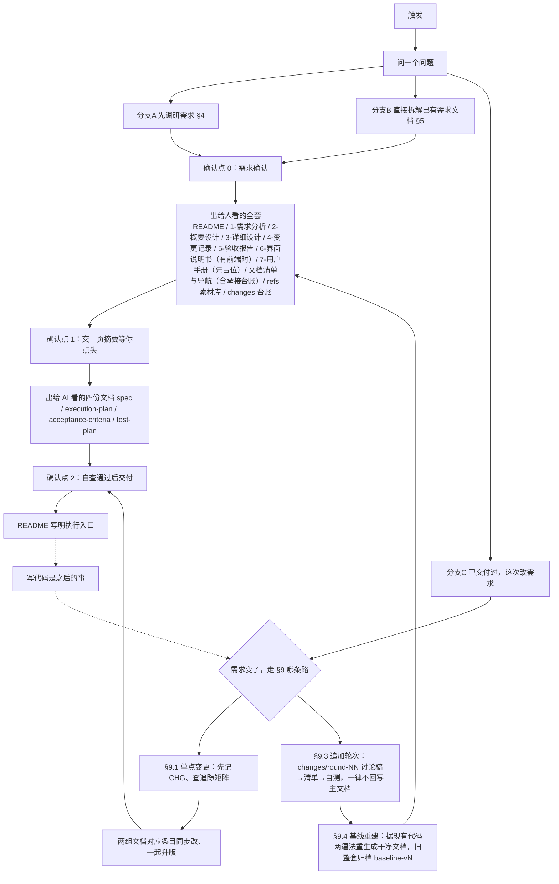

# Spec Forge — 写代码之前，先把文档做好

这个技能只做一件事：**动手写代码之前，先弄清楚要做什么，然后产出两组文档。**

- **给人看的文档**（放 `docs/` 下，中文命名）：需求分析、概要设计、详细设计、界面说明书（有前端时）、用户手册（后置）、变更记录。用大白话讲清楚为什么做、打算怎么做、后来改了什么。目的很实际——过半年回来看，你还能知道这个项目是干嘛的、当时为什么这么定。
- **给 AI 看的文档**（放 `docs/ai-docs/`，固定四份）：规格说明书（spec.md）、执行计划（execution-plan.md）、验收标准（acceptance-criteria.md）、自测计划（test-plan.md）。写得非常较真：需求逐条编号、验收标准每条都能判对错、禁止做什么写得明明白白。AI 拿到这四份，不需要再问任何人，就能把代码写出来、把测试跑通。

两组文档说的是同一件事：一组讲道理，一组立规矩，靠统一的编号互相对应。以后改需求时按编号反查，两边一起改，不会改漏。

> **本技能不区分项目大小，一律产全套文档**：小需求你也不会用这个技能，用上就说明项目值得完整文档。唯一例外：详细设计本身就很小（单模块、无复杂架构）时，概要设计可在确认点 1 经用户确认后省略——但默认要产。
>
> 本文件中标【强制】的步骤必须按序执行，跳步就是违规；标（可选）的才可以跳过。

## 0. 流程总览



> **总原则：动作贯通**。整套文档的交付标准不是"章节齐备、编号对齐"，而是——**随便挑一个用户动作，都能从触发源（界面元素 / 定时 / 事件 / 上游调用）一路走到落库，再走回来**；任何一环（模块 → 接口 → 底座调用 → 表 → 回传 → 失败降级）找不到落点，那份文档就等于没写。需求分析给核心场景步骤、概设给模块关系、详设给端到端链路表（第一权威）、ai-docs 给验收断言，都是围绕这一条服务的。

> **阶段切片（控制单次注意力，不削减强制项）**：每到一个阶段，只读该阶段需要的规则，其余跳过。**该查的项一个不少，只是分次查**——不要把 500 多行规则一次性压在上下文里。

| 阶段 | 只读这些 | 可跳过 |
|---|---|---|
| 定路（§1） | §1 | 其余全部 |
| 需求调研 / 拆解 | §4 或 §5、§3.1–§3.5、`templates/1-requirements.md` | §3.6、§3.7、§6–§11 |
| 确认点 0 | `checklists.md` 确认点 0、§3.7 F | 其余 |
| 概设 | §3.6、§3.7 B/C、`templates/2-overview-design.md` | §4、§5、§9 |
| 详设 | §3.7 C/D、`templates/3-detailed-design.md` | §4、§5、§9 |
| ai-docs | §3.4、§3.7 E、§7、`checklists.md` 确认点 2 | §4、§5、§9 |
| 交付后变更 | §9 | §4–§8 |

## 1. 第一步：问一个问题【强制】

触发技能后，只问一个选择题（给出推荐项和理由），不要让用户写作文：

| 情况 | 走哪条路 |
|---|---|
| 只有想法、说不清楚 | **分支 A：先调研需求**（见 §4） |
| 已有需求文档（PRD、需求段落、用户故事都算） | **分支 B：直接拆解**（见 §5） |
| 文档组已经交付过，这次是改需求 | 直接进 §9（单点变更 §9.1 / 首版后一轮轮追加 §9.3） |

**不再问项目大小、文档给谁看**——一律产固定全套（见 §2），不需要用户在这上面做选择题。

## 2. 必须产出的文档（固定全套）【强制：缺一份即违规】

```
docs/
├── README.md                  # 一句话定位 + 文档索引 + 执行入口
├── 1-需求分析.md               # 需求文档的根：做什么、做到什么程度
├── 2-概要设计.md              # 系统怎么搭、为什么这么搭（AD-x 唯一家）
├── 3-详细设计.md              # 主文档：总体架构 + 底座 + 公共约定 + 模块总览/动作清单/引用矩阵 + 横切
├── 3.0-详细设计.md            # 拆分时主文档改用这个名字（保证排在子文档之前；未拆分不出现）
├── 3.1-模块设计.md            # 拆分件：各模块 §2.x（预估 >60KB 或模块 ≥6 时才拆）
├── 3.2-接口契约.md            # 拆分件：§3 接口契约（唯一权威）
├── 3.3-数据设计.md            # 拆分件：§4 数据设计（唯一权威）
├── 3.4-界面索引.md            # 拆分件：§6 界面索引（有前端时）
├── 3.5-底座契约.md            # 条件件：底座账本 >20 行时才独立
├── 3.x-业务规则设计.md        # 条件件：判定 / 计算 / 推导类条目构成独立权威时（x 只表排序，不对应章节号）
├── 4-变更记录.md               # 单点变更的唯一入口
├── 5-验收报告.md              # 编码完成后逐条回填验收结果
├── 6-界面说明书.md            # 有前端时：人读界面说明（叙述式，非字段穷举）
├── 7-用户手册.md              # 占位：面向最终用户，需求基线确认后生成
├── 文档清单与导航.md          # 必产：文档状态唯一权威 + 需求承接台账（A/B 两段）
├── refs/                      # 主文档素材库：概设/详设主动调研拉取的外部参考件（唯一索引 refs/README.md）
├── changes/                   # 首版交付后追加需求：轮次台账 + 每轮讨论稿/清单/自测
│   ├── README.md              # 追加需求台账（每轮一行，唯一索引）
│   └── round-NN/              # 一轮一目录：discuss.md / todolist.md / test-plan.md / refs/
├── 开发过程文档备份/           # 基线重建后：旧整套文档归档（baseline-vN/），留痕不参与权威
├── 原型/                      # 有前端时（可选）
└── ai-docs/
    ├── spec.md                # 规格说明书：需求全集 + 技术栈 + 契约 + 禁止行为
    ├── rule-book.md           # 条件件：规则构成独立权威且体量大时（spec §7 引用它）
    ├── execution-plan.md      # 执行计划：执行纪律 + 任务清单 + 追踪矩阵
    ├── acceptance-criteria.md # 验收标准：每条都能判对错
    └── test-plan.md           # 自测计划：用例从验收标准派生
```

**条件件**（按需产出，不计入固定全套）：`6-界面说明书.md`（有前端时）、`原型/`（有前端时）、`changes/`（首版交付时先建空台账 + 模板站位，之后每轮追加）、`refs/`（概设/详设阶段调研到外部素材时建立，带 `refs/README.md` 索引）、`7-用户手册.md`（先建占位，需求基线冻结后填充）、`开发过程文档备份/`（基线重建时归档旧文档产出）、**详细设计拆分件 `3.1`–`3.5` 与 `3.x-业务规则设计`**（按下方拆分规则判定，模块数少且体量小则全部留主文档）、**`ai-docs/rule-book.md`**（条件件：规则多到构成独立权威时才拆，否则扩写进 `spec.md` §7；不新增固定第五件套）、**技术底座章节**（概设 §3.3 / 详设 §2.0：判定口径**唯一定义在概设 §3.3**，其余文件只引用不重定义——三条件（≥2 个模块共享同一非 CRUD 技术机制 / 该机制有自己的状态、调度或生命周期 / 需要独立的配置、观测、降级策略）**满足任一即判为有底座**，有则必产，判"无"时一行显式留痕）。

**详细设计的规模与拆分【强制，写之前判定】**：详设是本套文档里最大的一份，大项目常到 150–300KB，一次写不完还容易压缩细节。**判定**：预估正文 <60KB 且模块 <6 个 → **不拆**，全部内容在 `3-详细设计.md`；否则按下表拆（扁平放 `docs/` 根，**不建子目录**）。**预估口径**：模块数 × 每模块 8–12KB（链路表 + 类结构 + 流程 + 算法 + 条目规格）+ 主文档公共部分 15–25KB；拿不准按上限估，宁可早拆不要写崩再拆。

| 拆分件 | 承载 | 装什么 |
|---|---|---|
| `3.1-模块设计.md` | 详设 §2 | 各模块 §2.x（职责 / 承载条目 / 链路表 / 类 / 流程 / 算法 / 异常） |
| `3.2-接口契约.md` | 详设 §3 | API 清单 + 逐接口契约（唯一权威） |
| `3.3-数据设计.md` | 详设 §4 | ER + 表结构 + 字典索引（唯一权威） |
| `3.4-界面索引.md` | 详设 §6 | 界面元素 → 模块链路落点（有前端时） |
| `3.5-底座契约.md` | 详设 §2.0.2 | 条件件：账本 >20 行才独立 |
| `3.x-业务规则设计.md` | 详设 §2 中独立成册的条目规格 | 条件件：判定 / 计算 / 推导类条目的完整规格（五要素逐条） |
| `3.0-详细设计.md` | 详设 §0/§1/§2.0/§5 | 公共约定、**总体技术架构**、**模块总览 / 动作清单 / 引用矩阵**、底座、横切机制 |

四条规则：① **索引层唯一**——模块总览表、动作清单总表、引用矩阵只在主文档，拆分件不得另立；② **定义只写一次**——契约、表结构、底座能力、业务规则各有唯一权威文件，模块正文只写编号；③ **生成顺序**——先冻结索引 → 写 3.2/3.3/3.5（及 3.x 业务规则设计）→ 逐模块写 3.1 → 每册局部对账 → 全局扫悬空/孤儿；④ **兜底阈值（默认不触发）**——模块 ≥12 或 `3.1` >80KB 时按**模块组**拆（禁止每模块一份）。规模预估与拆分后的一致性机制详见详设模板开头。

**命名与编号三条（防误读）**：① 拆分后主文档改名 `3.0-详细设计.md`，保证任何文件管理器里都排在子文档之前；② 拆分件的 `3.x` **只表示排序，不承诺对应详设章节号**——对应关系写在每个文件头的"承载"行；③ 业务规则拆分件的名字用通用文档类型词 `业务规则设计`，不得换成具体业务领域的名称。

**唯一可省略项（固定全套内）**：详细设计本身就很小（单模块、无复杂架构）时，2-概要设计 可在确认点 1 经用户点头后省略。除此之外一份都不能少——尤其 **3-详细设计 必产**（数据库设计、表结构只在它里面，别处没有家）。**省略带来的两项判定必须下沉并留痕**：底座三条件判定改在详设 §2.0 就地执行（判"无"要写明"经三条件判定无底座"），调研触发判定改在详设 §1.1 就地执行（无实现点写"本期无需外部调研"）——**禁止因为上游文档不存在就静默跳过**。

## 2.1 血缘关系：文档是怎么长出来的【强制理解，生成时的依据】

这组文档不是并列的，是一条**逐级细化**的链。生成下一级时，上一级就是它的输入规范：

```
1-需求分析（源头：REQ / 范围 / 排除项 / BR 草稿）
   │ 细化：可增不可改
   ▼
2-概要设计（产品说明书 + 技术骨架：模块 / 选型 / 架构 / AD 决策）
   │ 细化：可增不可改                └─(取材：原型 + 概设 §3.2)→ 6-界面说明书（有前端时，人读）
   ▼                                                              │ 基线冻结后
3-详细设计（实现细节：接口 / 表结构 / 错误码 / 时序。契约诞生地，人类看）└─► 7-用户手册（先占位）
   │
   ├──────────────┐
   ▼              ▼
ai-docs/spec.md  （需求全集 ← 需求分析；契约 ← 详设。契约冻结地）
   │
   ├──→ execution-plan（任务 + 追踪矩阵）
   ├──→ acceptance-criteria（验收断言唯一权威）
   └──→ test-plan（用例，从 AC 派生）
```

交付后演进（追加需求轮次，§9.3）：`docs/changes/round-NN/` —— 讨论稿 → 干净清单 → 自测。
裁定：**后轮 > 前轮 > 主文档**；**一律不回写主文档**——基线开发做完后做一次**基线重建**（据现有代码+全部文档重生成干净文档），旧整套文档归档到 `docs/开发过程文档备份/baseline-vN/`。

四条规则（违反即漂移）：

1. **生成逐级向下**：每一级的来源是上一级 + 更上级的血缘（spec 的需求来自需求分析、契约来自详设）。生成下一级时必须读对应的上一级，不能凭空发挥。
2. **细化可增不可改**：下一级可以补充细节（如详设给概设定的模块补类结构、spec 给详设定的契约补工程约定），**但不能改上一级已定的语义**——spec 不能改需求分析的 REQ 范围和排除项，详设不能改概设的模块边界和 AD 决策。要改，走变更流程，不是生成时顺手改。
3. **执行只认最下游**：交付后 AI 干活只读 `ai-docs/` 四件套，不回看人类文档（自包含）；人类日常看概设、实现时看详设。两边是同一事实的两种视图，靠编号对应，靠"生成期对账 + 变更时同步"防漂移。
4. **承接不断链**：上一级的每一条，下一级必须**认领**或**登记例外**，落点统一记在 `文档清单与导航.md` 的承接台账（见 §3.7）。允许"需求未定，本期暂不做"，但不允许"不知道为什么没了"——细化可增不可改，但**不可丢**。

## 3. 全局规矩

### 3.1 编号系统（两组文档通用，禁止另造）

| 编号 | 含义 | 示例 |
|---|---|---|
| D-x | 需求调研时定下的事 | D-3 |
| SC-x | 核心场景 | SC-1 |
| EX-x | 明确排除项 | EX-1 |
| LAT-x | 后续路线（以后做，但非本期） | LAT-1 |
| RSK-x | 风险 | RSK-1 |
| API-x | 接口契约 | API-1 |
| TBD-x | 待用户拍板的问题（性质：阻塞/已假设） | TBD-2 |
| REQ-F-x.y / REQ-NF-x | 功能需求 / 非功能需求 | REQ-F-2.1 |
| BR-x | 业务规则 / 判定性条目（**贯穿线**：需求分析 §5 立项 → 概设认领 → 详设展开 → AC 断言 → 验收回填；**判据全文的唯一权威在详设 §2.x.7 或 `3.x-业务规则设计`，spec §7 是执行镜像、须与全文逐字一致**） | BR-4 |
| AD-x | 设计决策（**唯一家在 `2-概要设计.md` §9**） | AD-2 |
| T-x | 执行任务 | T-5 |
| T-{r}.{n} | 追加轮次任务（r=轮次序号，n=该轮第几条） | T-1.1 |
| C-{r}.{n} | 追加轮次结论（**唯一家在 `changes/round-NN/discuss.md` §6**，是本轮全部结论的分母） | C-1.2 |
| AD-{r}.{n} | 追加轮次设计决策（**唯一家在 `changes/round-NN/discuss.md` §3.2**；清单只引用，不重写论证） | AD-1.1 |
| REQ-F-{r}.{n} / REQ-NF-{r}.{n} | 追加轮次需求（新增或在轮内覆盖主文档条目；覆盖时注明被覆盖的编号） | REQ-F-1.1 |
| AC-x.y / AC-E-x / AC-NF-x | 验收标准（正常 / 排除项 / 非功能） | AC-3.1 |
| TC-x | 自测用例 | TC-7 |
| CHG-x | 一次变更（要写明：新增/修改/移除 + 是否破坏性） | CHG-1 |

追溯链：**REQ →（设计）AD →（任务）T →（验收）AC →（用例）TC**。改需求时按编号反查，两组文档受影响的条目一起改。

**BR 是第二条贯穿线**：BR 不只在需求分析与 spec 各写一份，它必须一路留下落点——概设认领（哪个模块承载）、详设展开（五要素规格）、AC 至少一条断言（判定 / 计算 / 推导类还必须含反例）、验收回填。落点全部记在 `文档清单与导航.md` 的承接台账里；**任何一条 BR 在各处都找不到落点，即判不合格**（查法见 §3.7 反向点名）。

**AC-x.y 编号语义**：x = 对应 REQ 的组号，y = 该组下第几条（例：AC-1.1、AC-1.2 都对应 REQ-F-1.x，不是 AC-1.2 对应 REQ-F-1.2）。

**被移除的需求（REMOVED），编号永远保留**：条目不删，改标 [REMOVED] 并注明是哪次变更（CHG-x）。防止需求悄悄消失、没人知道为什么。

### 3.2 文件放哪、叫什么

| 组 | 目录 | 命名 |
|---|---|---|
| 给人看的 | `docs/` | 中文命名，统一纯数字前缀（1-需求分析 / 2-概要设计 / 3-详细设计 / 4-变更记录 / 5-验收报告 / 6-界面说明书 / 7-用户手册）；**详细设计拆分件为 `3.x-<内容名>.md`**（`3.1-模块设计` / `3.2-接口契约` / `3.3-数据设计` / `3.4-界面索引` / `3.5-底座契约` / 条件件 `3.x-业务规则设计`），与主文档同级平铺；**拆分后主文档改名为 `3.0-详细设计.md`**（保证排在子文档之前） |
| 给 AI 看的 | `docs/ai-docs/` | 英文短名（不用考虑人的阅读体验，稳定优先） |
| 主文档素材库 | `docs/refs/` | 概设/详设主动调研拉取的外部参考件（可复用代码/算法/配置片段/截图），唯一索引 `refs/README.md`；**调研与索引机制见 §3.6**。**目录名用 `refs` 不用 `assets`**——避免与 Typora 等 Markdown 编辑器自动生成的图片附件目录 `assets/` 混淆 |
| 追加轮次 | `docs/changes/` | 轮次目录 `round-NN/`（英文短名，稳定优先），内含 `discuss.md` / `todolist.md` / `test-plan.md` / `refs/` |
| 过程备份 | `docs/开发过程文档备份/` | `baseline-vN/` 下整套旧文档（含已并入的 `changes/`），留痕用、不参与权威 |

### 3.3 给人看的文档怎么写

逐条执行 `templates/_writing-guide.md`。一句话概括：**像人话，不像机器人**——说事实、给理由、每段有干货；每张图后面必须有一段"这张图怎么读"；拿不准的话标 `[假设]` 并记入 TBD。

### 3.4 给 AI 看的文档怎么写

- **自包含**：四份文档互相引用可以，引用 `docs/` 下给人看的文档不行。AI 干活需要的所有事实（需求原文、技术栈、接口、错误处理、命令、前端的颜色间距数值）必须写在四份文档里面。
- **只立规矩，不讲道理**：条目化、编号化，不写背景故事（道理是给人看的文档的事）。
- **每条都能判对错**：写不出 pass/fail 的验收标准就是不合格。
- **给确定值**：技术栈、版本、命令、错误码必须写死；实在定不了的列 TBD，且**必须附上建议的默认值**——执行 AI 干活时旁边没人，得有兜底。

### 3.5 TBD 机制

遇到定不了的事，不要瞎猜：在文档里插 `⚠️ TBD-x`，文末汇总成清单，一次性交给用户拍板。

### 3.6 概设调研与素材库（refs）机制【强制】

> **概要设计不是"凭知识库一路设计到底"。** 有实现难度的点**必须在概设阶段就上网调研**，并把外部素材**落盘 + 登记索引**——概设不提，详设更不会提，最后只能凭想象实现。本节把"何时调研 / 怎么调研 / 素材怎么管"定成硬机制，概设、详设、追加轮次共用。

**A. 什么时候必须调研（触发条件）**

出概要设计时逐模块扫一遍实现点，命中任一即**必须主动检索**（不是可选）：

- 实现有难度、或**可能已有成熟开源做法**：大文件流式渲染、章节/正文自动提取、文本净化正则、海量文件扫描、二进制或 EPUB/PDF 元数据解析、并发去重与幂等、批量导入导出、增量同步……；
- **性能/内存/IO 有硬约束**，需参考别人怎么扛（十万级列表、50MB 文本、高并发写）；
- 团队**不熟悉**的领域或技术栈。

**示例不止文档处理**：支付幂等与对账、权限模型的判定与继承、实时推送的断线重连与去重、批量任务的分片与限流、搜索排序的相关性调参，与上面列举的文档类场景是同一判定口径。**不要因为示例里出现"文档处理"就把触发范围收窄到那一类**——判据只有三条：实现有难度 / 可能已有成熟开源做法 / 性能或内存有硬约束。

**纯 CRUD、纯字段增删改查**凭知识库设计即可，不调研；本期确无此类实现点时，在概设 §12 写"本期无需外部调研"。

**B. 调研四步（按序，缺一步即不合格）**

1. **点名**：在概设 §3.2 该模块的「关键实现点（点名 + 提要求）」写下这个点，并给出概设层要求（性能 / 边界 / 约束）——**只点名提要求，不写做法**（做法留详设）。
2. **检索**：主动上网找现成方案（项目 / GitHub / 官方文档），**至少看两个来源再取舍**；只找到一个也要说明为何没得比。
3. **落盘**：把可复用的代码 / 算法 / 配置片段 / 截图**下载存到 `docs/refs/`**——**不要只存链接**（链接会失效，执行 AI 也拿不到原件）。
4. **登记**：把结论写进概设 §12「调研记录」，并在 `docs/refs/README.md` 索引逐条登记（列见 C）。

**C. 素材库索引（`docs/refs/README.md`，唯一索引）**

索引表每行一条素材，列固定，**缺列即不合格**：

| 列 | 填什么 |
|---|---|
| # | 序号 |
| 实现点 | 对应概设 §3.2 / §12 的哪个实现点 |
| 来源 | 项目名 / URL / commit（附链接） |
| 落盘文件 | `refs/xxx`（相对 `docs/` 的路径，文件必须真实存在） |
| 用它的哪段 | 具体到函数 / 文件 / 片段，禁止"参考一下" |
| 怎么融合 | 拿进来怎么改、放在哪 |
| 引用处 | 概设 §12 / 详设 §2.x.5 / 轮次 todolist |

- **一处索引**：主文档素材只登记在 `docs/refs/README.md`；追加轮次的素材登记在该轮 `discuss.md` §4，**不并入**主索引。
- **目录名固定 `refs`**，不用 `assets`（避免与 Typora 等编辑器的图片附件目录混淆）。

**D. 与详设、与追加轮次的衔接**

- 概设调研只到"点名 + 提要求 + 登记来源"；**详设阶段在对应模块「非平凡算法」（§2.x.5）继续就地深入**，新素材续入 `docs/refs/` 并在同一索引**追加行**。
- 追加轮次的素材走 `docs/changes/round-NN/refs/`，**不回写主库**（索引写在该轮 `discuss.md` §4）。

**红线**：只在文档里写一句"参考某项目"不算数——**没落盘 = 没调研**。执行 AI 找不到原件，只能凭想象实现，偏差就是这么产生的。

### 3.7 承接台账与条目精度【强制，v2.0 核心机制】

> **治什么病**：需求里写下的每一条，到了概设、详设、验收里悄悄消失——有的被压缩成一句"由某机制驱动"，有的整段不见，有的当时就决定不做、却只留在需求里，后面看设计的人以为"当初没提"。**章节齐备、编号对齐都不等于承接住了**。本节把"每一条都去哪了"变成可机械核对的东西。

#### A. 承接台账（唯一权威在 `文档清单与导航.md`）

- **为什么住导航文档，不住需求文档**：若需求、概设、详设各写一遍承接记录，就会有三份说法、三处漂移——那正是要治的病。台账放在所有人都会先看的导航文档里，与文档状态、数字口径同处唯一权威。
- **A 段 · 常规表**（机械核对，不写理由）：`条目编号 | 概设落点 | 详设落点 | 状态`
- **B 段 · 例外表**（只登记不走常规路径的，必须写原因与决策人）：`条目编号 | 例外类型 | 原因 | 决策人/日期 | 下游如何引用`
- **状态只有固定五值**，不允许自由发挥：

| 状态 | 含义 |
|---|---|
| 已承接 | 概设认领，详设已展开到可执行 |
| 已细化 | 概设认领，详设已写全五要素（判定 / 计算 / 推导类） |
| 需求未定暂不做 | 需求阶段就没定，暂不做（必须在 B 段留原因） |
| 本期不做 | 明确排除（对应 EX-x），必须在 B 段留原因 |
| 合并至 X | 与另一条合并，指向合并目标 |

**任何一条需求或规则只有这五种去向，不存在"下落不明"**。台账里的概设 / 详设落点必须能点开核对，禁止写"见相关章节"这类无法定位的话。

#### B. 条目类型学与展开精度（不靠判断力，查表）

需求条目先标类型，再按类型决定设计展开到什么精度：

| 类型 | 长什么样 | 设计落点 | 精度要求 |
|---|---|---|---|
| 定义类 | 术语、字段含义、口径 | 术语表 / 数据字典 | 一句话讲准 |
| 约束类 | 永远成立：必须 / 禁止 | 状态机 / 权限 / 架构守卫 | 谁受约束 + 违反怎么办 |
| 流程类 | 先后顺序、状态迁移 | 链路表 / 状态机 | 顺序 + 中断处理 |
| 判定类 | 当…且…时，做… | 模块设计的条目规格小节 | **五要素** |
| 计算类 | 公式、阈值、档位、区间 | 模块设计 / 参数表 | **五要素** |
| 推导类 | 由已有数据推出结论 | 模块设计 | **五要素** |

**五要素（可执行门槛）**——只写"支持 XX"而不写这五样的，判为不可执行：

1. **触发条件**——什么时候开始判；
2. **判定条件**——怎么算命中（**含边界值**：等于阈值、空值、最小值、最大量、并列）；
3. **例外与覆盖**——什么**不算**命中、多条同时命中谁优先；
4. **结果动作**——命中了做什么（**含失败怎么办**）；
5. **位置与顺序**——在流程哪一步执行、与谁抢先后。

**阈值与取值必须写来源**（需求原文 / 调研素材 / 决策记录）。技能不替项目定业务判据，但必须把判据的来源钉住——否则详设成了凭空发挥。

#### C. 独立成册：用权威边界判定，不用条数阈值

判定三问，**满足任一即独立成册**：

1. **有无独立消费方**：除本模块外，别的模块 / 运行时 / 配置 / 运营 / 外部系统也要读它；
2. **有无独立变更节奏**：内容因业务原因频繁增删，而模块代码不常动；
3. **需求里是否已是可维护清单**：条目会持续增删，而非一次性定死。

三条全否 → 融进模块小节，用"条目规格"写清五要素即可。数量只作兜底（真塞不下时自然满足第 1 条）。**不设条数阈值**——"超过 N 条就必须拆"既漏真正该拆的，也逼出不该拆的。

独立成册的文件名为 `3.x-业务规则设计.md`：`业务规则` 是通用的文档类型词，**禁止换成具体业务领域的名称**；`x` 只表排序，对应关系写文件头"承载"行。

#### D. 反向点名（唯一能发现"整类内容缺席"的检查）

交付前（确认点 1 与确认点 2 各一次），**按需求条目花名册逐条去台账查下落**：每一条 REQ / BR 是否都有状态、概设落点、详设落点？状态为"需求未定暂不做 / 本期不做"的，B 段有无原因与下游引用方式？

- **正向检查对"缺席"是盲的**：逐节读设计，读不出"本该有、但没有"的内容；
- **反向点名专治这个**：以需求全集为分母逐条点名，缺一条即不合格；
- 反向点名还要查**下游**：AC 里有没有对应断言、验收报告里有没有回填。

#### E. 验收锚定（判定 / 计算 / 推导类必须含反例）

判定类、计算类、推导类条目，**每条至少 1 条验收标准，且必须含反例**——"该命中的命中了" + "**不该命中的确实没被命中**"。只测正例的验收挡不住误伤，而误伤恰恰是这类条目最常见的缺陷。

#### F. 需求对抗性审查（8 条，确认点 0 前逐条过）

需求阶段就要把"遗传病"拦住，否则后面每一级都在替它背锅：

| # | 检查项 | 不合格的处理 |
|---|---|---|
| 1 | 每条需求能否写出"验收时怎么判" | 降级为 TBD，标注"需求未定" |
| 2 | 边界值写了吗（等于阈值 / 空值 / 最小值 / 最大量 / 并列） | 补边界，否则设计无法判 |
| 3 | 例外与反例写了吗（什么情况**不算**、什么情况**不该做**） | 补反例，否则验收抓不住误伤 |
| 4 | 与已有需求有无冲突（同一对象两个不同取值） | 当场定取舍并记 D-x，禁止含糊并存 |
| 5 | 排除项是否写明理由，会不会被误读成遗漏 | 补理由，进台账 B 段 |
| 6 | 术语全篇一致吗，有无同物异名 | 统一并进术语表 |
| 7 | 非功能需求有可测数字吗（性能 / 容量 / 超时） | 补数字或标"未定" |
| 8 | 依赖与前置条件写了吗（外部系统 / 权限 / 数据来源） | 补依赖，进约束节 |

**允许"暂时不知道"**：需求确实没想好的，标注"需求未定"，**但必须一路传下去**——概设、详设、台账 B 段都要留同一句话"因需求未定，本期暂不做"。**不允许只留在需求里**：那样后面看设计的人会以为当初没提。反过来，要区分两种沉默——"需求未定"（想不出）与"本期不做"（明确排除），二者都要留痕，不得混为一谈。

**存量项目的处理（显式留痕）**：本机制只对 v2.0 之后新生成的项目生效。**存量项目不做回填迁移**——已交付的文档组保持原样，等各自下次大改或基线重建时自然获得新机制。这不是遗漏，是明确取舍，避免为历史项目做一次收益低于成本的批量补账。

## 4. 分支 A：需求调研（用户只有想法时）【强制按序】

1. **让用户先说完**，不打断。
2. **复述确认**：用自己的话复述一遍理解（"我听到的是：你要给 X 人群做 Y，解决 Z 这个问题，对吗？"），用户点头后才进入下一轮。这一步不做，3 轮问题可能全部问偏，代价是需求分析建立在误解上。
3. **分批提问**，按下面 8 类，先问范围再问细节。优先出选择题，每批 **3-4 个**（宿主交互卡片单轮通常限 4 问），**总共不超过 3 轮**——问不出来的部分，按合理假设填进文档，标 `[假设]`，记入 TBD（性质标"已假设"），不再追问。建议的 3 轮批次（可微调）：
   - **第 1 轮**：目标与范围 + 现状方案 + 利益相关者 + 约束依赖
   - **第 2 轮**：用户与场景 + 功能需求（含异常流程）
   - **第 3 轮**：非功能需求 + 优先级 + 验收偏好
   - 问询类别（8 类）：
   - 目标与范围（做什么、明确不做什么、**现在是怎么解决的、卡在哪**、**完全新建还是改造现有系统/代码——现有资产在哪**）
   - 利益相关者（最终用户、拍板的人、技术相关方、合规安全——缺谁问谁）
   - 用户与场景（谁用、什么环境、核心流程、**多少人用/同时多少人/一年多少数据**、**角色间权限是否不同——谁能看/改/删**）
   - 功能需求（正常流程、出了错怎么办）
   - 非功能需求（性能、安全、兼容性、易用性，逐类问；缺类标"不适用"）
   - 约束与依赖（技术栈限制、要对接的系统——**对方给什么协议和认证方式/有没有接口文档/稳不稳有没有 SLA**、数据：存量/量级/隐私保留要求、有没有死线、一次交付还是分期）
   - 优先级（用 MoSCoW 问：哪些必须做、哪些应该做、哪些可以做、哪些明确不做）
   - 验收偏好（做到什么程度算做完、**谁来验收/在什么环境验收/要不要演示特定场景**）
   - **冲突处理**：用户前后回答打架，或两轮之间改了主意——记 D-x 写明取舍理由，或升 TBD 交用户拍板，不许自行抹平。
4. **优先级换算（写死）**：Must→P0、Should→P1、Could→P2、**Won't→排除项候选**（用户确认后才写进排除项）。**P0/P1/P2 语义**：P0 = 不做就不算交付；P1 = 本期尽力做；P2 = 有时间才做。**防"全是 Must"**：若 Must 超过需求总量一半（或用户全标 Must），追问"只许做一半，先砍哪些"，迫使用户排序，并把追问结果记 D-x。
5. **每个决定记一笔**（D-x：决定了什么、为什么），写进需求分析的决策记录节。
6. **第 3 轮末尾查漏**：对照易忘功能清单问一句"有没有这几类"——通知（邮件/短信/Webhook）、报表与导出、管理后台/配置界面、历史数据迁移。
7. **需求对抗性审查**：按 §3.7F 的 8 条逐条过一遍需求全集（验收可判性 / 边界值 / 例外反例 / 需求间冲突 / 排除理由 / 术语一致 / 非功能数字 / 依赖前置）。答不出的降级为 TBD 标"需求未定"，**并在文档里写明"因需求未定，本期暂不做"，供后续各级承接**。
8. **确认点 0**：交摘要（模板见 §8），用户点头后才往下走。

## 5. 分支 B：已有需求文档拆解

1. **通读原文档**，拆成一条条需求（REQ），标注来自原文哪一节。
2. **六问查缺口**：每条需求有验收标准吗？非功能需求有吗？出错的流程覆盖了吗？术语前后一致吗？写"不做什么"了吗？**需求之间有矛盾吗（相互冲突或与约束冲突）**？
3. **需求对抗性审查**：按 §3.7F 的 8 条逐条过需求全集；答不出的降级为 TBD 标"需求未定"，并写明"因需求未定，本期暂不做"，供后续承接。
4. **缺口和矛盾列成 TBD 清单，一次问完**。
5. **文档如果已经比较结构化**（有模块划分、优先级、验收标准、用户故事），按这张表直接落位，能省不少事：

   | 原文档里的东西 | 放到哪 |
   |---|---|
   | 模块/大功能划分 | 需求分析的模块分组 |
   | 需求条目 | REQ-F 编号条目 |
   | 用户故事 | REQ 的"场景来源"字段 |
   | MoSCoW 优先级 | P0/P1/P2（按 §4 第 4 步换算；Won't 进排除项候选） |
   | Given-When-Then 验收 | 直接作为验收标准（AC）的素材 |
   | 利益相关者 / 非功能需求 | 需求分析对应章节 |

6. **确认点 0**：需求条目全集用户点头后，进入文档产出。

## 6. 出文档（一）：给人看的【确认点 1】

按固定全套产出（清单见 §2）：

1. **README.md**：一句话定位 + 文档清单 + 执行入口（写法见 §10）。
2. **1-需求分析.md**：背景与目标、利益相关者与用户、核心场景（SC-x）、功能需求表（编号/描述/**条目类型**/优先级/一句话验收/场景来源；**P0 的需求必须附 Given-When-Then 三行草案**）、**业务规则（BR 草稿，逐条标条目类型，判定/计算/推导类附五要素提示）**、非功能四类（性能/安全(含合规)/兼容性/易用性）、范围与排除项（EX-x）、**后续路线（LAT-x）**、约束与时间线、**风险（RSK-x）**、决策记录（D-x）、术语表、TBD（含性质列）。**每条需求都必须能回答"验收怎么判"**——答不出的降级为 TBD 标"需求未定"，并在原地写明"因需求未定，本期暂不做"；§3.7F 的 8 条对抗性审查结论要能对上。
3. **2-概要设计.md**：**产品说明书 + 技术骨架**（平时看得最多的文档）——架构风格及理由、架构图（图后必带解读）、**模块总览表（含用途/输入→产出/上下游/对外契约列）+ 按模块展开的简单说明（谁触发/拿到什么/吐什么、不负责什么、**承载需求条目**、对外契约与底座调用点、失败时怎么办；关键实现点（点名+提要求），CRUD 不展开）**、**技术底座（概设 §3.3 条件件：三条件满足任一即判为有底座，有则必产登记表，无则一行显式留痕）**、**需求承接（§3.4：逐条认领与例外登记，判定/计算/推导类只点名不写做法；台账权威仍在导航文档）**、技术选型（每项绑定理由与被否决方案）、数据概要、部署视图、非功能对策、错误处理策略、**设计决策记录（AD-x 唯一家）**、安全设计、部署与可观测性、**调研记录（§12）**。**重功能描述、可读性优先**：不写做法（做法留详设），但**必须点名关键实现点并给出要求**——概设不提，详设更不会提；凡有实现难度、可能已有成熟做法的点（大文件流式渲染、章节自动提取、文本净化、海量文件扫描……）须**主动上网调研**（**触发条件与四步流程见 §3.6**），结论落 §12「调研记录」，外部素材落盘 `docs/refs/` 并在 `docs/refs/README.md` 索引。**唯一可省略件**：详细设计本身很小、经用户确认后可省。
4. **3-详细设计.md（+ 按规模拆分的 3.1–3.5、3.x 业务规则设计）**：**必产**——**开工先判定规模**（见 §2「详细设计的规模与拆分」）：不拆则全部写在本文件；拆则主文档改名 `3.0-详细设计.md`，留 §0 公共约定、**§1 架构与模块总览**（§1.1 **总体技术架构**（技术栈定版 / 分层与依赖方向 / 部署单元）、§1.2 模块总览表、§1.3 **动作清单总表**、§1.4 **引用矩阵**、§1.5 硬门槛）、**§2.0 技术底座**（调用点账本 EXT-x）、§5 横切机制；其余按拆分件落位：§2 各模块详设（**承载条目清单** / 职责与功能点清单 / **端到端链路表（每模块必产，第一权威）** / **条目规格（判定 / 计算 / 推导类逐条写五要素）** / 类图 / 时序图 / 伪代码 / 异常边界）→ `3.1-模块设计.md`，§3 接口设计（API-x + 契约完整）→ `3.2-接口契约.md`，§4 数据库设计（ER + 每表独立小节 + 字典与索引）→ `3.3-数据设计.md`，§6 界面映射（七列，全局索引）→ `3.4-界面索引.md`，账本 >20 行 → `3.5-底座契约.md`。**条目规格按 §3.7C 权威边界三问判定是否独立成册**（独立则 `3.x-业务规则设计.md`，x 只表排序）。**索引层唯一**：模块总览、动作清单、引用矩阵只在主文档。**生成顺序**：先冻结索引 → 写 3.2/3.3/3.5 → 逐模块写 3.1 → 每册局部对账 → 全局扫悬空/孤儿。**概设 §3.2 点名的关键实现点必须在对应模块逐一展开**（非平凡算法按 §1.5 硬门槛写，禁止一句概括带过）；调研素材续入 `docs/refs/`（按 §3.6C 在索引**追加行**）并回链 §12 调研记录。**表结构格式：每张表单独一节（标题=表名+表注释），字段表含字段名/类型/约束/字段注释，禁止把所有表挤进一张大表。**
5. **6-界面说明书.md**（仅当项目有前端界面时）：**人读叙述式**的界面说明——讲清"界面上有什么、怎么操作、能做成什么事"，不写字段穷举式规格、不写后端实现与接口细节。取材：原型 + 概设 §3.2。产出条件与写法见模板 `templates/6-ui-guide.md`。**它是界面规格的正式交付物**，原型本身不必再转写一份机械规格文档。
6. **7-用户手册.md**（先占位）：面向最终用户的操作指引——**需求设计阶段生不出来**，此处只放占位骨架（`templates/7-user-manual.md`），等需求基线冻结、系统可跑之后再据实填充。
7. **4-变更记录.md** + **changes/**：变更记录空表起步；同时建 `changes/README.md`（追加需求台账，空表起步）与 `changes/round-NN/` 目录骨架（`discuss.md` / `todolist.md` / `test-plan.md` 三份模板 + `refs/` 素材目录，首版交付后每轮追加时启用，见 §9.3）；并建 `docs/refs/`（素材库，带 `refs/README.md` 索引，概设/详设调研时填充）。
8. **原型/**（有前端时，可选）：出一个 HTML 原型给你确认观感——颜色对不对看原型比看文档直接得多。颜色间距的数值本身内联进 ai-docs/spec.md，不单独写一份设计规范文档。**原型规范**：命名 `原型/<页面名>.html`，一页一份；页面必须覆盖五态（正常/空/加载/错误/无权限）中适用的状态；用户否决原型后，修订原型再进入确认点 1——不把否决的观感问题带进 AI 文档。
9. **5-验收报告.md**：空表起步（编码完成后回填）。**文档清单与导航.md**：**必产**（不是可选）——它是文档状态与数字口径的唯一权威，同时承载**需求承接台账**（A/B 两段、五状态，见 §3.7A）。
10. 按 `checklists.md` 的确认点 1 清单自查 → **交一页摘要**（模板见 §8）→ 用户点头后冻结。

## 7. 出文档（二）：给 AI 看的四份【确认点 2】

输入：已确认的需求分析、概要设计、详细设计（只是生成素材，交付后 AI 干活不回来看它们）。

1. **spec.md**：为什么做/本期做什么/影响面、术语表、技术栈与依赖（写死版本）、**需求全集（每条用"当…时，系统应…"的句式写完整，标 [ADDED]，并标条目类型）**、范围边界（含禁止实现清单）、输入输出契约（API-x）、**业务规则（判定 / 计算 / 推导类逐条带五要素摘要；规则多到构成独立权威时拆条件件 `ai-docs/rule-book.md`，由 spec §7 引用——不新增固定第五件套）**、状态机、错误处理策略、验收索引、工程约定（目录结构、构建/测试/运行命令、环境变量、**前端的颜色间距数值**）、设计约束（**每条配"怎么检查违没违反"的方法**）、禁止行为、遗留事项、完成定义。
2. **execution-plan.md**：**执行纪律四件套**（先定接口再写码 / 每步自查清单 / Git 提交节奏 / 卡住 3 次必须停下来报告）+ 哪些必须串行（写明原因）+ 工程结构 + 任务依赖图 + 任务清单（每条带完成标准和验证命令）+ **追踪矩阵**（REQ→AD→API→T→AC→TC 一张表，改需求时靠它查影响面）。
3. **acceptance-criteria.md**：验收断言全集（Given-When-Then + 判定准则），含"系统不应"的排除项验收、非功能验收。**判定 / 计算 / 推导类条目每条至少 1 条 AC，且必须含反例**（该命中的命中 + 不该命中的确实没被命中）。**全组只有这一份写验收断言**，别处只放索引。
4. **test-plan.md**：从验收标准机械派生——环境与命令、用例表（引用 AC 编号）、需求↔验收↔用例覆盖对照表（必须 100%）、回归范围。

任务超过 ~30 个：执行计划拆成 `ai-docs/execution-plan/` 总览 + 分批的分册。

**自查必须做三件事**（checklists.md 确认点 2）：

- **装傻测试**：假装自己是一个只拿到 `ai-docs/` 四份文档、完全不了解背景的执行者，逐项确认能不能开工。**必须在独立上下文 / 新会话中执行**——生成者自己复读会不自觉补全缺项，测不出自足性。
- **生成期对账**：需求/详设 与 AI 文档逐项对齐——REQ/排除项/BR 与需求分析对，API/表/错误码/枚举/技术栈与详设对，编号全库反查无悬空、无复用，数量级口径一致（见 checklists 确认点 2 的"生成期对账"四组检查）。**这步是防漂移的主闸门，不是可选项。** 详设拆了册的，额外查：**引用矩阵无悬空、无孤儿**，拆分件与主文档的编号一字不差，模块总览/动作清单只有主文档一份。
- **对表**：验收标准与需求分析 P0 的三行是否一致（或已按"草案可修正"在确认点 1 摘要说明）；追踪矩阵是否覆盖全部非 [REMOVED] 需求。

→ **交一页摘要** → 用户点头后交付。

## 8. 每道确认点的摘要模板【强制，一屏以内】

用户不该为了确认而硬读四份契约文档。每个确认点按这个格式交摘要：

```text
【确认点 N】<这步做了什么>
- 产出了：<文档清单，每份一行>
- 范围：<一句话；共几条需求，P0 几条>
- 明确不做：<最多 5 条>
- 风险：<最多 3 条，从需求分析 §9 RSK-x 取，不现场编>
- 等你拍板的 TBD：<只列"阻塞"项：编号 + 事项 + 我建议的默认值>
- 可否决的假设：<列"已假设"项：编号 + 我替你定的 + 理由>
- 贯通抽样：<确认点 1/2 必带：贴 2 条完整链路——触发源 → 接口 → 落库 → 回传 → 失败降级，让用户亲眼验证贯通；确认点 0 无设计，略>
- 承接覆盖：<确认点 1/2 必带：需求与规则共 X 条，有落点 X 条；例外 Z 条（逐条一句原因）；已跑反向点名，缺失 0 条>
- 需要你确认：<1-3 个具体问题>
```

用户看完摘要就能拍板；想看细节再打开对应文档。

## 9. 交付之后：需求变了怎么办

交付之后的每一次需求变化，按规模走两条不同的路：

- **A. 单点变更**（改一条需求、加一个字段这类小范围调整）→ §9.1
- **B. 追加需求轮次**（首版交付后，想法一批一批地来，一轮一轮追加）→ §9.3

两条路共同的底线：**先记变更、再动文档，禁止绕过**；都要更新"与代码同步截止"。真实项目大多从 A 起步、很快演变成 B——首版一跑起来，"我还想加个…"会持续好几轮。

### 9.1 单点变更流程

1. **先记 `4-变更记录.md`**：变更类型（新增/修改/移除）+ 是否破坏性；**移除（REMOVED）必须写清理由和怎么迁移**，否则拒绝进入修订。
2. 按 ai-docs/execution-plan.md 的追踪矩阵反查影响面，两组文档受影响条目**一起改、版本一起升**，更新"与代码同步截止"；**同步更新 `文档清单与导航.md` §2 承接台账**（新增条目补行、落点变更重指、转"本期不做"移入 B 段并写原因），改完重跑一次反向点名。
3. 移除的需求在 spec.md 里保留编号、改标 [REMOVED]，注明是哪次变更——**不许物理删除**。
4. 破坏性变更必须重走确认点 1。
5. **版本号递增规则**：小改（改措辞、补说明、不改变行为）→ minor（v1.1）；改行为 / 加删需求 / 动契约 → major（v2.0）；破坏性变更**必须**升 major。
6. **与 §9.3 的分界**：以上是"一次性小改、改完主文档仍是唯一权威"的经典路径。**一旦进入追加轮次模式**（首版交付后想法连续多轮地来、`changes/` 已启用），主文档即冻结、**此后一切变更（哪怕只是单点小改）都走 §9.3 的那一轮**，不再走本节——两种模式不要混用，否则主文档会被零星回写、又回到"反复冲突"的老问题。

### 9.2 确认点 1 → 确认点 2 之间的回退

> 交付尚未完成（还在出 AI 文档阶段）时发现契约有缺口需要补设计，**不算"交付后变更"**，不记 CHG。处理：回到确认点 1 修订对应的给人看文档（需求分析 / 概要设计 / 详细设计），确认点 1 已冻结的部分按"修改设计 = 重走确认点 1"处理（用户点头），然后继续确认点 2。这一小段回退不需要开变更记录——变更记录从交付后（确认点 2 通过）才开始计。

### 9.3 追加需求轮次（首版交付后，一轮一轮追加）【强制按序】

> **为什么单开一条路**：首版交付后追加的想法，**不能往主文档里塞**。主文档已经冻结、是所有文档的血缘源头，每轮追加都去改它，一是重复读取主文档容易把上一轮的上下文读偏，二是新旧要求混在一起读，读者无所适从。所以追加需求单独落 `docs/changes/`，**一轮一目录，与主文档物理隔离**；主文档保持冻结不变，只有真动了已定语义时才回写（见下方裁定规则）。每一轮内部把"过程"与"结论"也分开——讨论稿留过程、干净清单给执行，AI 才不会在长讨论里丢上下文。

**一轮的标准动作（四步，按序）：**

1. **开轮建档**：在 `docs/changes/README.md` 台账追加一行（轮次号 / 日期 / 一句话主题 / 状态），并建 `docs/changes/round-NN/`（NN 两位序号，从 `round-01` 起）。台账模板 `templates/round-index.md`，轮内三份模板 `round-discuss.md` / `round-todolist.md` / `round-test-plan.md`。
2. **讨论 + 中立评审**（落盘 `round-NN/discuss.md`）：用户与 AI 多轮讨论，结论**边聊边落盘**到讨论稿。**先分轨**——AI 给每条需求标类型，再决定要不要评审：
   - **先判级（L1 / L2）**：按详设 §1.5 的六条硬门槛 + 第 ⑦ 条（替换或重构既有技术机制：底座 / 引擎 / 调度 / 协议 / 存储方案）判定，结论写进讨论稿 §0.1。**L1** = 可枚举的确定性变更（加按钮 / 接口 / 字段、CRUD、改文案）；**L2** = 非平凡变更，需求只给约束与目标、**方案本身是设计产物**。**没判级不得开讨论。**
   - **L2 必须在讨论稿里把方案定下来**（§3.2，`AD-{r}.{n}` 的唯一家）：候选 ≥2（确无第二方案写"唯一方案 + 理由"）→ 取舍（否决了什么、为什么）→ 选定 → 关键结构（按 §1.5 四要素：输入输出 / 步骤 / 参数与阈值 / 失败边界与性能量级）；含判定再补五要素，参数写初值并标"待实测"。**L2 缺这一节不得冻结清单**；**L1 整节跳过**，写了反而算过度设计。
   - **界面 / 交互类调整**：以**用户为准**，直接执行，不做技术评审（界面好不好用户说了算）。讨论稿本类只记一句"用户主张，无异议"。
   - **后台 / 架构类优化**：【强制】先做**中立评审**——AI 读完现有代码与设计后，逐条回答**三问**：① 现状**是否已实现**这个需求？② 现状**是否比用户要求更优**（若更优，必须明确写"不建议改"并给理由，**不许顺着用户附和**）？③ 有没有**第三条更优方案**？评审结论落讨论稿。**这是前置闸门：本轮只要有架构类需求，三问未答完、或未得出"改 / 不改 / 换方案"结论，不得进入下一步 `todolist.md` 冻结。** 这一条正是冲着"用户提的架构优化可能不合理、照改反而把更优的现状改差"来的——评审必须真站中立客观立场，不是走过场。
   - **参考素材必须落盘**（机制同 §3.6）：讨论中提到的现成项目、GitHub 片段、算法实现，一律下载备份到 `round-NN/refs/`，讨论稿写清"素材文件 → 用它的哪一段 → 怎么融合进来"。**禁止只在文档里写一句"参考某项目"**——执行时 AI 找不到原件，只能凭想象实现，偏差就是这么产生的。
   - **结论必须编号**：讨论稿 §6 的每条结论取 `C-{r}.{n}`（r = 轮次序号）+ 需求编号 + 一句话验收。这是清单承接映射的分母——**没编号就点不了名，讨论清楚的内容正是在这一步静默消失的**。
3. **冻结提炼干净清单**（`round-NN/todolist.md`）：讨论定稿后，从讨论稿提炼出**干净**的执行清单——只留"要做什么、怎么改、参考什么、完成标准、核销、测试"。讨论过程中的分歧与被否决的想法留在 `discuss.md`，不进清单。**这份清单是本轮详细设计的简化版，不是任务标题集合**——讨论稿管"把事讨论清楚"，它管"照着改"；只写"调整 XX 逻辑"的，等于没写。清单结构 = 开头一张**承接映射表**（`discuss.md` §6 的每条结论 `C-{r}.{n}` → `T-x` → `TC-x`，明确不做的写"不做 + 原因"，**任一结论没有任务即不得冻结**）+ 每条任务如下栏位：

   | 栏位 | 内容 |
   |---|---|
   | 对应结论 | `C-{r}.{n}`（可多条，须能在承接映射表反查） |
   | 设计决策 | `AD-{r}.{n}`（L2 必填，可多条；L1 填"无"） |
   | 任务编号 | T-{r}.{n}（r = 轮次序号，n = 该轮第几条） |
   | 要改的项目 / 文件 | 精确到文件路径，不写"某个模块" |
   | 现状 | 现在的行为 / 结构，落到函数、字段、分支；禁止"现状正常""有点乱" |
   | 目标（改后） | 改成什么样，与"现状"逐点对应；**必须有细节**，含糊即退回重写 |
   | 变更类型附加细节（命中才展开） | 接口：请求/响应逐字段 + 逐错误码触发条件 + 兼容期与调用方清单 · 数据：字段/默认值/索引 + 旧数据迁移与回滚 · 规则：**L1** 展开五要素（触发/判定含边界/例外与覆盖/结果动作含失败/位置与顺序）+ 阈值来源，**L2** 五要素已在 `AD-{r}.{n}` 定稿、此处只写落位（函数/字段/参数初值/配置键） · 界面：五态 + 交互与校验时机 · 配置权限：键名/默认值/生效范围或权限码与校验点 |
   | 参考素材 | `refs/xxx` → 用哪段 → 怎么融合 |
   | 中立评审 | （架构类必填）结论：改 / 不改 / 换方案（详见讨论稿 §3） |
   | 完成标准（DoD） | 做到什么算完成（照抄主文档 DoD 口径；至少含一条反例口径） |
   | 核销 | 开发后逐条勾（开发完没有） |
   | 测试 | 对应自测用例编号（TC）+ 覆盖类型（正常/边界/反例/错误路径） |

   **轮次新需求也要有需求编号**：每条新需求取 `REQ-F-{r}.{n}` / `REQ-NF-{r}.{n}`（r = 轮次序号），并在清单里写明它**新增 / 覆盖 / 替代**了主文档的哪条 REQ；被替代的条目在 §D 对照表登记（仍不回写主文档）。**没有 REQ 编号的需求不得进清单**——否则追加期只有任务号，验收和反向点名都无法按需求回溯。

   清单末尾附一张**与主文档的对照表**：本轮若动了主文档已定语义，逐条登记冲突并裁定以本轮为准——**登记但不回写主文档**（见下），无冲突则写"无"。

   **精度红线（轮次版，口径同详设 §1.6）**：任务写不出"改成什么样、边界值、失败怎么办"的，视为未完成，退回重写。自检方式——把这条任务单独交给一个不知道本轮背景的人，他能否直接动手改。

   **设计决策只写一次（L2 专属）**：清单只做**落位**（改哪个文件 / 函数 / 字段、任务切分、DoD、测试），设计论证**只引用 `AD-{r}.{n}`、不重写**；清单里出现讨论稿没有的设计决策 = 越权，回讨论稿补并升版，不许就地改。这与主链路"AD 只在概设 §9 定义、别处只引用"是同一条规矩——**同一层细节只写一次，上下只引用不复制**，否则必然双写漂移。

   **承接必须闭环（轮次版反向点名）**：`discuss.md` §6 的每条结论都要在清单里有任务、在 `test-plan.md` 里有用例；冻结前反向查一遍——**结论没任务 = 讨论白做了，任务没结论 = 凭空加活**，两种都不许。主链路靠 `文档清单与导航.md` 的承接台账防丢，轮次链路靠这张表，道理相同。

   **微改免清单的硬条件**（三条同时满足；任一不满足就必须产清单 + 自测计划）：① 不新增/修改接口、表结构、状态机、业务规则、权限、配置项；② 不改变既有对外行为（仅文案/样式/日志/注释，或行为等价重构）；③ 不新增依赖、不涉及数据迁移。免清单须在 `discuss.md` §6 显式留痕，禁止静默跳过。

4. **执行 → 核销 → 自测**：**开工门禁见本轮 `discuss.md` §0——`todolist.md` 未冻结，不得写下第一行生产代码**（生成 `discuss.md` 后直接开发即为违规）；按 `todolist.md` 执行；开发完后**逐条核销**（对照 DoD）；再按 `round-NN/test-plan.md` 由 **AI 自己跑**自测并核销——**测试不许留给人工执行**。

**裁定规则（冲突时谁说了算）**：**后轮 > 前轮 > 主文档**。后提的要求覆盖先提的，追加轮次覆盖主文档。

**一律不回写主文档**：追加轮次只改代码，**不回头改需求分析/概设/详设/spec**——哪怕某轮动了主文档已定的语义，也不逐轮回写。理由：逐轮回写会与主文档反复冲突，变更细节一层层堆上去，读的人头痛、文档也不干净（这正是本机制要避免的）。追加期主文档保持"冻结在确认点 2 的快照"状态：在 `docs/README.md` 与主文档头部标一行"**追加期以 `changes/` 最新轮为准**"；动了主文档已定语义的轮次，在该轮 `todolist.md` §D 登记冲突，并在 `4-变更记录.md` 留一条 CHG-x **备查**（不据此修改主文档）。

**收尾动作——基线重建（不逐轮回写，一次性重建）**：等一个**基线开发**做完（追加需求趋于稳定，或你判断到了一个里程碑），做一次重建，而不是逐轮灌。**重建怎么做才不丢细节，见 §9.4（不是把旧文档删减重排，而是按两遍法由代码重新穷举）**：

1. 输入 = **现有代码 + 全部既有文档 + 全部已核销轮次清单**；输出 = **一套干净的给人看文档 + ai-docs 四件套**——把这一阶段的 N 轮追加**全部并进**新基线，版本从 **v2.0** 起（动了行为，升 major）。**方法按 §9.4 两遍法执行。**
2. 把**旧的整套 `docs/` 文档组**（连同这一阶段已并入的 `changes/round-NN/`）整体搬到 **`docs/开发过程文档备份/baseline-vN/`**，作为**开发过程备份**留痕（可追溯、不再作为权威）。
3. **轮次编号继续递增**（不归零重开）：跨基线全局唯一，"见 round-07"永远指向同一件事。`changes/README.md` 台账保留全部历史行，已并入的轮次标"**已并入 baseline-vN**"。
4. 重建后可回到确认点 1 / 2 走一遍（新基线同样要用户点头才冻结）。

### 9.4 基线重建规程：据代码回溯生成干净文档【强制按序】

> **触发**：§9.3 收尾动作（一个基线开发做完）。**本规程是"重建"的执行方法**，专门治"重新生成一遍结果还是太省"这个顽疾。
>
> **为什么单独定规程**：新建文档是**从需求往代码方向走**（先有需求、再设计）；**回溯是反方向——从代码往文档方向走**。模型默认行为是"归纳压缩"：若只笼统地"照代码再写一遍文档"，它会把实现细节压成一句"实现了 X"，读者看不出到底做到了什么程度——旧文档正是这么丢的细节。根治手段是**强制工序（两遍法）+ 内容覆盖对账**，光靠改措辞是治不好的。

**两遍法（禁止一遍写完正文）：**

1. **第一遍 · 穷举（不写正文，先列表）**：以**现有代码为唯一事实基准**（**以源码仓库为准；打包 / 压缩后的构建产物跳过**），自顶向下（目录 → 模块 → 文件 → 关键函数/组件）扫描，产出一张**「实现点清单」**——把代码里真实存在的每一项逐条罗列：关键算法、状态流转、边界与容错处理、错误码与异常策略、业务规则、数据表/字段、接口、配置项，以及（有前端时）每个界面的操作与交互点。**这一遍只列"有什么"，不解释、不评价。** 历史主文档与过程文档在此仅作**线索**（提示"这里可能有个坑"），**不作为事实来源**——事实一律回代码核对。
2. **第二遍 · 逐点落位（扩写）**：拿着清单，逐条去目标文档里找"它落在哪一节"，**找不到的必须新增叙述**。每条不得只写"实现了 X"，至少写到 **是什么 · 为什么这么定 · 关键参数/边界值 · 失败时怎么办** 四要素（对照 3-详细设计 §1.5 硬门槛与 `_writing-guide` 细节维度）。**禁止先写概述再回头补**——必须先穷举、再落位。

**内容覆盖对账闸门（强制；与 §7 的"生成期对账"是两回事）：**

- §7 的生成期对账验的是**编号一致**（REQ/API/表/错误码在两侧对得上）；**本闸门验的是内容覆盖**——代码里的关键机制，文档里**必须都有叙述**。
- 做法：生成完毕后**逆向抽查**，两层：① 按模块抽取代码中的关键实现点（随机或全量，每模块至少 3 条：算法 / 边界 / 错误处理 / 交互点），回查目标文档有无对应叙述；② **抽 ≥3 个用户动作走全链**（含 1 个纯后端触发源：定时/事件/上游调用）——从触发源 → 接口 → 底座/模块 → 落库 → 回传 → 失败降级，任何一环在文档里找不到落点即判不合格。**凡"代码里存在、文档里查不到"的，一律判不合格，补写后重跑本次抽查。**
- 抽查记录（抽了什么、查到没有）落 `docs/开发过程文档备份/` 的重建说明，供日后追溯。

**辅助材料使用纪律**：旧主文档与过程文档只提供**措辞与历史取舍理由**；与代码冲突时**一律以代码为准**，并在重建说明里记一笔"旧文档说 X、代码实为 Y"。

**回溯场景的额外落点**：1-需求分析的功能需求表须同时标注**实现现状**（已实现 / 部分实现 / 未实现 + 落点），避免读者误以为"没做"；概设 §12 调研记录与详设的调研素材在重建时一并据代码校验是否已落地。

## 10. 交付时：把执行入口写清楚【强制】

交付时必须在 `docs/README.md` 写明：

1. 项目一句话定位。
2. 文档清单（哪份给谁读）。
3. **执行入口**：新的编码会话**先读 `ai-docs/spec.md`，再读 `execution-plan.md` 的执行纪律**，然后按任务清单干；自测按 test-plan.md；任何变更先记 `4-变更记录.md`，禁止绕过。**追加期（`changes/` 已启用后）另写一条读序**：先读 `changes/README.md` 找到最新轮 → 读该轮 `todolist.md` → 再读 `spec.md` 作基线；**冲突按「后轮 > 前轮 > 主文档」裁定，被本轮覆盖的条款以清单为准**，主文档保持冻结不改。把"追加期读什么、谁优先"写进执行入口，别把消歧留给执行 AI 的自觉。
4. 如果宿主项目有 AGENTS.md 之类的规则文件：提醒用户把执行入口写进去，让每次会话自动加载。

本技能的职责到确认点 2 交付为止。写代码，是之后的事。

## 11. 模板清单

| 产出文档（写入项目时的名字） | 模板文件（技能源码，纯 ASCII） |
|---|---|
| README.md | `templates/README-template.md` |
| 1-需求分析.md | `templates/1-requirements.md` |
| 2-概要设计.md | `templates/2-overview-design.md` |
| 3-详细设计.md | `templates/3-detailed-design.md` |
| 4-变更记录.md | `templates/4-changelog.md` |
| 5-验收报告.md | `templates/5-acceptance-report.md` |
| 6-界面说明书.md（有前端时） | `templates/6-ui-guide.md` |
| 7-用户手册.md（先占位） | `templates/7-user-manual.md` |
| changes/README.md（追加需求台账） | `templates/round-index.md` |
| changes/round-NN/discuss.md（讨论稿） | `templates/round-discuss.md` |
| changes/round-NN/todolist.md（干净清单） | `templates/round-todolist.md` |
| changes/round-NN/test-plan.md（本轮自测） | `templates/round-test-plan.md` |
| 文档清单与导航.md（必产：含承接台账） | `templates/doc-nav.md` |
| refs/README.md（主文档素材库索引） | `templates/refs-index.md` |
| 写作规范（无产出，纯执行规范） | `templates/_writing-guide.md` |
| ai-docs 四件套 | `templates/ai-docs/` 下同名 |
| 自查清单 | `checklists.md` |

> **详细设计拆分件（`3.1-模块设计` / `3.2-接口契约` / `3.3-数据设计` / `3.4-界面索引` / `3.5-底座契约` / `3.x-业务规则设计`）没有独立模板文件**——它们是 `3-detailed-design.md` 按节拆分后的产物，各节原文即模板，落位规则见详设模板开头"规模与拆分"；拆分后主文档改名 `3.0-详细设计.md`。

> 模板路径相对于本 SKILL.md 所在目录。**templates/ 目录就是 docs/ 的镜像**——docs 里每个产出文件对应 templates 里一个模板，一一对应。`docs/refs/`（主文档素材库索引）与 `docs/changes/round-NN/`（轮内讨论稿/清单/自测）是仅有的目录/嵌套结构，其相关模板在 templates/ 下平铺（`refs-index.md`、`round-discuss.md` 等），复制到项目时按左列路径落位。
>
> **命名约束（硬性）**：技能源码内的模板文件名**必须纯 ASCII**（安装时中文文件名会被宿主编码链路破坏成乱码，导致按 SKILL.md 找模板时 Read 失败）；但**产出文档写入项目 `docs/` 时必须按左列中文名命名**（1-需求分析.md 等），给人看的中文命名惯例只约束产出物，不约束技能源码。读模板、写产出是两步，别把模板的 ASCII 名带进 docs/。
