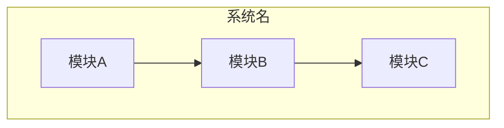
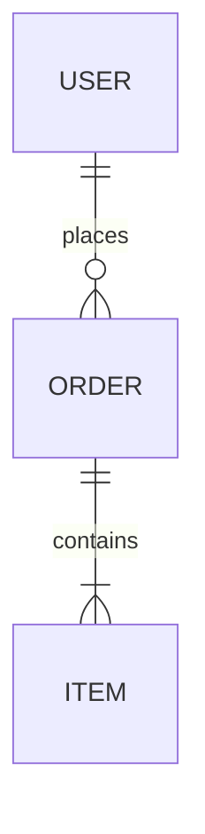
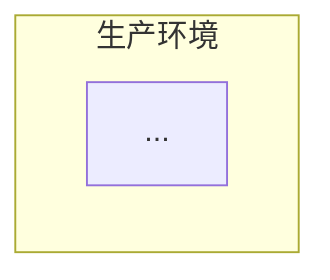

# 模板：2-概要设计

> 使用说明：`docs/2-概要设计.md`。**定位：产品说明书 + 技术骨架**。平时看得最多的文档——读者是有技术背景但非底层程序员的人，重功能描述、可读性优先。讲"系统怎么搭，为什么这么搭"，技术选型带理由，但**不写具体做法**（做法留详设）。**两点必须做到**：① **点名关键实现点并给出要求**——概设只"提要求、点名难点"，不展开做法；概设不提，详设更不会提，细节就这么丢了。② **非 CRUD 的实现点须主动调研**（大文件流式渲染、章节自动提取、文本净化、海量文件扫描这类有实现难度、可能已有成熟做法的点），结论落 §12「调研记录」，外部素材落盘 `docs/refs/` 并索引——简单 CRUD 凭知识库设计即可，不必调研。**默认流程都要产出**；只有详细设计本身就很小（单模块、无复杂架构）的项目才可省。设计决策（AD-x）唯一存档在本文件 §9。叙述遵守 `_writing-guide.md`（`templates/_writing-guide.md`）。状态流转：草稿 → 已冻结（确认点 1）。

---

# 概要设计：[项目名称]

| 项 | 内容 |
|---|---|
| 版本 | v1.0 |
| 日期 | YYYY-MM-DD |
| 状态 | 草稿 / 已冻结 |
| 上游 | 1-需求分析 vX.Y |
| 与代码同步截止 | |

## 1. 设计概述

一段话交代：这份设计覆盖什么、不覆盖什么；为满足需求分析的哪些条目而存在；设计目标与非功能约束。范围边界和需求分析的排除项呼应。

## 2. 系统架构

### 2.1 架构风格与理由

（选了什么风格：分层 / 微服务 / 事件驱动 / 单体模块化 / Serverless……为什么它适合这份需求。❌「我们采用微服务架构」——空话。✅「拆成三个服务，因为订单和库存的扩容节奏完全不同，单体发布会互相拖住」`[经验]`）

### 2.2 架构图

### 2.3 图怎么读

（每张图后面必须跟一段解读：从上往下/从外往里是什么，关键调用链怎么走，哪个环节是瓶颈或单点。孤图不合格。）

## 3. 模块划分

### 3.1 模块总览表

（一张表扫清全貌：每个模块**做什么用、吃什么吐什么、和谁对接、对外有什么契约**。模块含"和"说不清用途的，说明切错了，拆开。依赖方向不允许成环。列要求：
- **用途**：必须回答"没有这个模块，用户/系统会失去什么"——**禁止名词短语式职责**（"负责 XX 的管理"不算说清）；
- **对外契约**：填 API-x / EXT-x / AIC-x 编号（没有写"无"），**禁止"契约见详设"一语带过**——概设至少要点名契约存在；
- **上下游**：依赖谁 / 被谁依赖，改这里会牵动谁。）

| 模块 | 用途（做什么用） | 输入 → 产出 | 上下游 | 对外契约 | 关联 REQ |
|---|---|---|---|---|---|
| | | | | 无 / API-x / EXT-x | REQ-F-x.y |

### 3.2 模块说明（按上表逐一展开）

> **定位：产品说明书式展开**——给有技术背景但非底层程序员的人看。每个模块一个小节，讲清：**职责、内容、关键实现点**，外加**贯通三问**（谁触发 / 拿到什么 / 失败怎么办——答不了的模块等于没说清，见 `_writing-guide.md` 禁令）。要求：
> - 内容 = 这个模块做什么、包含哪些功能点，用大白话
> - 关键实现点 = **只讲存在麻烦点或较复杂实现的模块**；CRUD 这类本身没问题的不用写；没有坑点的模块只写职责和内容
> - 技术细节（类结构/表结构/时序/具体做法）不写，那是详设的事——但**关系必须写**（上下游、对外契约、外部能力调用点），"关系不是细节"

#### 模块 A [名称]

- **职责**：（这个模块负责什么，一句话；说不清含"和"，通常该拆）
- **内容（功能点清单）**：（包含哪些功能点，大白话列举，3-8 条）
- **谁触发 / 拿到什么 / 吐什么**：（触发源：界面操作 / 定时 / 事件 / 上游模块；输入；产出）
- **不负责什么**：（边界一句话，防"这个模块好像什么都管"）
- **对外契约与外部能力调用点**：（提供哪些 API-x；调用了哪些 API / 底座能力 EXT-x——有底座时必填，对应 §3.3 账本编号）
- **关键实现点（点名 + 提要求）**：（**仅当有复杂点/麻烦点时写，只点名、提要求，不写做法**。点名"有哪些必须实现的点"，并在概设层给**要求/约束**——如"50MB 文本必须流式渲染，禁止整文件载入内存""章节提取须容错 UTF-8 / GB18030 混杂编码"。做法留给详设。没有坑点写"无"，CRUD 类不用写。凡点名的实现点须在 §12 调研记录中登记，并在详设对应模块的「非平凡算法」（§2.x.5）展开。）

#### 模块 B [名称]

- **职责**：
- **内容**：
- **谁触发 / 拿到什么 / 吐什么**：
- **不负责什么**：
- **对外契约与外部能力调用点**：
- **关键实现点（点名 + 提要求）**：（无则写"无"）

### 3.3 技术底座（条件件：有则必产、无则显式留痕，禁止静默跳过）

> **判定（满足任一即有底座）**：① ≥2 个模块共享同一个非 CRUD 的技术机制（编排 / 规则 / 告警 / 流程 / 流式 / 同步引擎……）；② 该机制有自己的状态、调度或生命周期，不是一次请求内的简单逻辑；③ 它需要独立的配置、观测、降级策略。
>
> **边界**：用了 Redis / 消息队列这类中间件**不算**底座（那是 §4 技术选型的事）；**自己设计、被多模块调用的"引擎"才算**。单模块独享的复杂逻辑留在该模块的「非平凡算法」里，不进本节。
>
> **双向留痕**：有 → 本节必产（详设 §2.0 展开契约全文）；**无 → 此处写"经判定无技术底座（已逐条对过三条件）"**，禁止静默跳过。

| 底座 | 一句话能力 | 为什么需要（关联 AD） | 支撑哪些模块 | 对外契约点 | 详设落点 |
|---|---|---|---|---|---|
| 例：AI 编排运行时 | 提示词装配、调用、结构化校验与降级 | AD-3 | 世界观 / 大纲 / 卷纲… | EXT-1~5 | 详设 §2.0 |

（概设层只"点名 + 提要求"，不展开做法；每个契约点须登记编号，**调用它的模块在 §3.2 填对应编号**，详设 §2.0 写契约全文与联动反向索引。）

## 4. 技术选型

| 技术点 | 选型 | 为什么选它 | 被否决方案及原因 | 关联 AD | 依据 |
|---|---|---|---|---|---|
| | | | | AD-x | `[调研/经验]` |

（红线：每项选型必须绑定它服务的非功能约束——性能、成本、团队能力、运维复杂度。"用 Redis"是评审意见，"用 Redis 扛读热点，因为它支持 sub-ms 读写且挂了只影响缓存 `[经验]`"才是决策。版本号不确定就标 `[待确认]`，不许编。）

## 5. 数据设计概要

核心实体及关系：

（表结构、索引、字典的完整定义在详细设计，此处只画骨架。图后带解读。）

## 6. 部署视图

## 7. 非功能性设计对策

| 非功能目标 | 设计对策 | 对应模块 |
|---|---|---|
| 例：P95 < 500ms | 读写分离 + 缓存热点 key | |

（❌ 复述目标。✅ 每个目标给一条具体设计策略，说明它如何达成目标。）

## 8. 错误处理策略

| 失败场景 | 处理策略 | 说明 |
|---|---|---|
| 依赖服务超时 | 重试 N 次 → 熔断 → 降级 | |
| 重复请求 | 幂等键 | |
| 部分写入失败 | 补偿/对账 | |

## 9. 设计决策记录

（AD-x 的唯一家。）

| 编号 | 决策 | 理由 | 关联 REQ | 状态 |
|---|---|---|---|---|
| AD-1 | | | | 已定 / ⚠️ TBD-x |

## 10. 安全设计（涉及账号、敏感数据、对外服务时必须有）

| 项 | 设计 |
|---|---|
| 认证与会话 | 例：JWT + 刷新机制 + 登出黑名单 |
| 授权与数据权限 | 例：RBAC + 数据范围 |
| 敏感数据保护 | 例：字段加密存储、传输加密、日志脱敏 |
| 审计 | 例：关键操作注解式日志 |

## 11. 部署与可观测性（by case）

| 项 | 设计 |
|---|---|
| 部署形态 | 例：Docker Compose 本地 / Helm 生产 |
| 配置管理 | 例：环境变量 + 配置文件分层 |
| 监控告警 | 例：健康检查端点 + 指标暴露 + 告警规则 |
| 日志策略 | 例：结构化日志、按天滚动、保留期 |
| 备份恢复 | 例：数据库备份频率与恢复演练 |

## 12. 调研记录（概设阶段：非 CRUD 的实现点须主动调研）

> **为什么要调研**：概设阶段就要把"需要上网查的东西"查出来。**简单 CRUD 凭知识库设计即可**；**凡有实现难度、可能已有成熟做法的点**（示例如大文件流式渲染、章节自动提取、文本净化正则、海量文件扫描、EPUB 元数据解析……），此处**必须主动检索**现成方案，避免详设阶段闭门造车、凭想象发明。**概设阶段的调研结论必须落本表**，供详设继续深入。
>
> **纪律三条**：① 每条写清"参考了谁（附链接 / 项目名 / commit）+ 本项目采用还是否决 + 理由"，**不写评价性空话**；② 找到的可复用代码 / 算法 / 配置片段 / 截图**下载落盘到 `docs/refs/`**（**目录名用 `refs` 不用 `assets`**——避免与 Typora 等 Markdown 编辑器自动生成的图片附件目录 `assets/` 混淆），并在 `docs/refs/README.md` 索引；③ 详设阶段在对应模块的「非平凡算法」（§2.x.5）继续就地深入调研，素材续入 `docs/refs/`。
>
> **红线**：只在文档里写一句"参考某项目"不算数——执行 AI 找不到原件，只能凭想象实现，偏差就是这么产生的。本期实无非 CRUD 实现点时，写"本期无需外部调研"。

| # | 实现点 | 难点 / 为什么要调研 | 概设层要求（性能 / 边界 / 约束） | 调研来源（项目 / URL，附链接） | 本项目取舍（采用 / 否决 + 理由） | 素材落盘（`refs/...`） | 详设落点 |
|---|---|---|---|---|---|---|---|
| 1 | | | | | | | §2.x.5 |

## 13. 验收演示脚本（可选，供验收与汇报用）

> "覆盖 AC"列在确认点 2 之后回填（AC 编号在确认点 1 时尚不存在）。

| 场景 | 演示步骤 | 预期结果 | 覆盖 AC |
|---|---|---|---|
| 例：核心流程演示 | | | AC-x.y |
