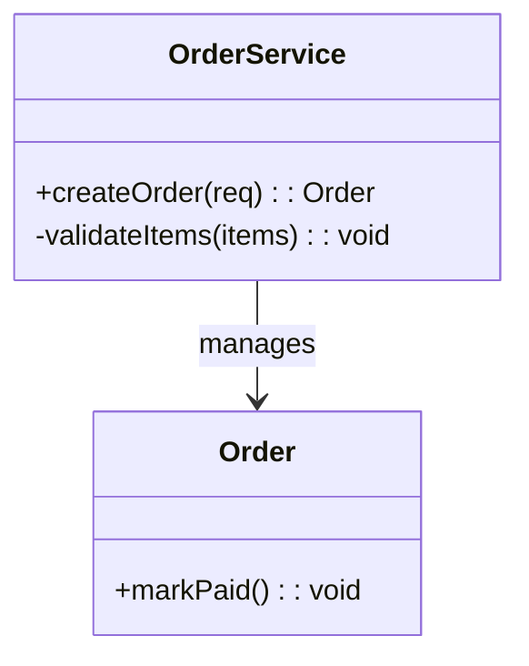
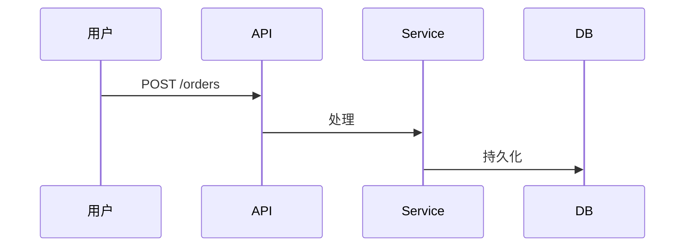
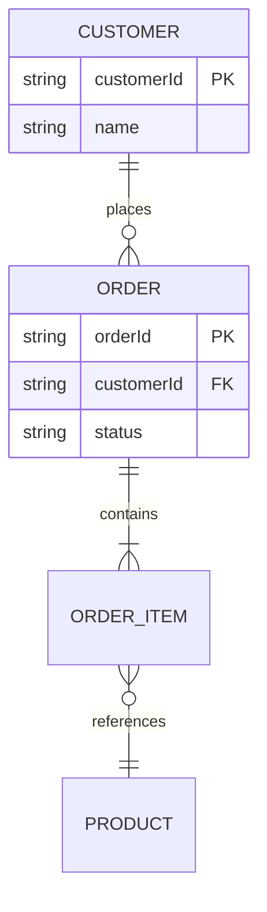

# 模板：3-详细设计

> 使用说明：`docs/3-详细设计.md`。**必产文档**——概要设计讲清"为什么这么搭"，详细设计讲清"每个模块具体怎么实现"——接口契约、数据结构、关键流程、非平凡算法、**数据库设计**。可按模块拆为多文件放进 `docs/detailed/` 子目录。叙述遵守 `_writing-guide.md`（`templates/_writing-guide.md`）。
>
> 三条硬要求：① 开篇 **§1「模块总览」**给出模块全集与各模块功能点清单——**让读者一眼看清"系统由哪些模块组成、各有哪些功能"**（与概设 §3.1/§3.2 一致，冲突以概设为准）；② **概设 §3.2 点名的每个关键实现点，必须在本文件对应模块逐一展开**（详设是"展开"的落点，概设点到了而这里不写，就等于没人写）；③ 有前端时须产出 **§6「界面触发与前后端职责映射」**，把界面元素与后端处理对应起来。调研素材落 `docs/refs/` 并回链概设 §12 调研记录。
>
> 红线：每个图后必须有文字解读；接口定义必须完整到下游工程师不用猜（编号 API-x）；非平凡算法按 **§1.2 硬门槛**写、禁止一句概括带过，但也不贴整段源码凑数。状态流转：草稿 → 已冻结（确认点 1）。

---

# 详细设计：[项目名称]

| 项 | 内容 |
|---|---|
| 版本 | v1.0 |
| 日期 | YYYY-MM-DD |
| 状态 | 草稿 / 已冻结 |
| 上游 | 2-概要设计 vX.Y |
| 与代码同步截止 | |

## 文档导读

> 本文件按"宪法 → 模块总览 → 模块详设 → 共享面"组织，读法如下：
> - **§0 公共约定**：全系统共享的命名/错误码/枚举/"参考源映射"，是所有模块的宪法，先读。
> - **§1 模块总览**：一张表看清**系统由哪些模块组成、各模块有哪些功能**（模块 → 一句话职责 → 关联 REQ → 本文件章节 → 代码落点）。**只想了解模块与功能面貌的读者，读到 §1 即可**。§1.2 是写模块详设前必读的"非平凡算法硬门槛"。
> - **§2 各模块详设**：每个模块一小节（职责与功能点清单 → 类结构 → 关键流程 → 非平凡算法 → 异常边界），只读你关心的模块。
> - **§3 接口设计**：全系统接口清单 + 逐接口契约（编号 API-x），是 spec.md 契约的内联源。
> - **§4 数据设计**：ER 全图 + 每张表独立小节的表结构 + 数据字典与索引策略（数据库设计的唯一归宿）。
> - **§5 横切机制**：日志/错误码/鉴权/事务/配置等跨模块机制。
> - **§6 界面触发与前后端职责映射**（有前端时）：界面元素 → 触发命令 → 前端做什么 / 后端做什么 / 性能算法注意。
>
> 阅读顺序建议：只想看清模块与功能 → §1；全新读者 §0 → §4（先看数据长什么样）→ §3 → 目标模块；改接口先查 [§3 接口清单](#3-接口设计)。

## 0. 公共约定（全模块共享，先于此冻结）

> 本节是所有模块设计的"宪法"：模块分册只引用本节，不复写。**任何模块设计与本节冲突，以本节为准，回头修订模块设计；确需修改本节，走变更流程（4-变更记录）**。

### 0.1 命名规范

（包/类/表/字段/接口/API 路径的命名规则；代码标识符英文、注释中文。）

### 0.2 公共响应与错误码

统一响应结构：（成功/失败的响应体格式，分页结构，时间格式，ID 类型）

| 错误码 | 含义 | HTTP 状态 |
|---|---|---|
| 例：`AUTH-001` | | |

### 0.3 枚举字典

（全系统枚举集中注册：状态机取值、类型字典——各模块只能引用，不得新增同义枚举。）

| 枚举 | 取值 | 说明 |
|---|---|---|
| | | |

### 0.4 参考源映射（有原型/旧代码/mock 数据时必填）

| 参考源 | 作用域 | 本设计继承点 |
|---|---|---|
| 例：旧版 mock_data.py | GUI 展示字段 | 字段映射见各模块详设 |

## 1. 模块总览

> **本文件开篇先给全貌，再进细节。** 模块全集与 2-概要设计 §3.1「模块总览表」**保持一致**——详设只做"镜像 + 落到实现"，**冲突时以概设 §3.1 为准并回改本表**，禁止两份文档各写一套（防漂移）。

### 1.1 模块总览表

| 模块 | 一句话职责 | 关联 REQ | 本文件章节 | 代码落点 |
|---|---|---|---|---|
| 例：订单模块 | 下单 / 支付 / 退款的状态流转 | REQ-F-2.x | [§2.1](#21-模块-a-详设) | `src/order/` |
| | | | | |

（每个模块一行；模块数、名称、职责须与 2-概要设计 §3.1 逐行对得上，不一致时**以概设 §3.1 为准回改本表**。增删模块走变更流程，不在此处顺手改。**模块依赖关系见 2-概要设计 §3.1，此处不重复**——本表只给"有哪些模块"，各模块**有哪些功能**见 §2 各模块的「功能点清单」。**按模块拆为多文件（`docs/detailed/`）时，"本文件章节"列填对应分文件路径，§2.x 编号落到各分文件内。**）

### 1.2 非平凡算法硬门槛（全模块通用，写模块详设前必读）

> **硬门槛（禁止以"逻辑直观"为由省略——这正是细节丢失的主因）**：凡命中以下任一，即属**非平凡**，必须在对应模块的「非平凡算法」小节展开：
> ① 状态机 / 多步流转；② 并发 / 去重 / 幂等 / 重试；③ 算法（匹配、排序、提取、解析、压缩、加密、批量或流式处理）；④ 边界与容错（大文件、超时、部分失败、脏数据）；⑤ 性能门槛（大数据量、内存 / IO 受限）。
>
> **每段必须写到四要素**：输入 → 输出；步骤（伪代码或流程）；关键参数与阈值（超时值 / 批大小 / 正则 / 复杂度）；失败与边界处理 + 性能量级（复杂度 / 内存 / 耗时）。
>
> **反省略自查**：写完对照 2-概要设计 §3.2 的「关键实现点」清单与 §12 调研记录，逐点确认"概设点到的实现点在此均有展开"——**概设提了而详设没展开，即不合格**。平凡的 CRUD 不贴代码凑数，但也不得用"实现相关逻辑"这类句子带过。

## 2. 各模块详设

> 每个模块一小节，结构统一：**职责与功能点清单 → 类结构 → 关键流程 → 非平凡算法 → 异常边界**。前端模块按同构详设：类结构 → 组件结构（组件树 / 状态管理 / 路由），关键流程 → 关键交互流程图，接口定义 → 组件 Props 契约。视觉 token 值以内联形式存在于 `ai-docs/spec.md` 工程约定节，实现时直接引用，不写死颜色/间距值。**前端占比高的项目：把前端各模块独立成小节（如 §2.3 前端模块详设），含组件树/状态管理/路由/Props 契约，不要塞在括号说明里。**

### 2.1 模块 A 详设

#### 2.1.1 职责与功能点清单

**职责**：（这个模块拥有什么能力，一句话。职责含"和"或一句说不清，通常说明模块切错了，应拆开。实现需求分析的哪些 REQ。）

**功能点清单**（本模块对外提供的功能点，逐一列；对应 2-概要设计 §3.2 的「内容」）：

| 功能点 | 一句话说明 | 关联 REQ / 接口 |
|---|---|---|
| | | REQ-F-x.y / API-x |

#### 2.1.2 类结构

（图后解读：各类的职责、关键方法为什么长这样、关系是组合还是依赖。）

#### 2.1.3 关键流程

（图后解读：正常路径怎么走；上面至少有一条错误路径（超时/库存不足/校验失败）。）

#### 2.1.4 非平凡算法

（先按 §1.2 硬门槛判断本模块有无非平凡点：有则按四要素逐段展开；没有就写"本模块无非平凡算法"，不要留空。）

#### 2.1.5 异常与边界处理

| 场景 | 处理策略 | 关联 BR |
|---|---|---|
| | | |

### 2.2 模块 B 详设（同构）

（结构同 §2.1，逐节补齐：职责与功能点清单 → 类结构 → 关键流程 → 非平凡算法 → 异常与边界。前端模块按 §2 开头说明的同构方式处理。）

## 3. 接口设计

### 3.1 接口清单

（每个接口一个编号 API-x，供追踪矩阵和变更影响分析引用。同一接口在模块详设、架构图、清单、spec.md 里出现时必须一字不差。）

| 接口编号 | 接口 | 方法 | 用途 | 关联模块 | 详设章节 |
|---|---|---|---|---|---|
| API-1 | | | | | [§2.1.3 关键流程](#213-关键流程) / [§2.2 模块 B 详设](#22-模块-b-详设同构) |

### 3.2 接口契约

（每个接口一节，完整到调用方不用问。同一份接口在模块详设、架构图、清单里出现时必须一字不差。给 AI 用的契约同步内联到 `ai-docs/spec.md`。）

| 项 | 内容 |
|---|---|
| 操作 | `POST /orders` |
| 用途 | 创建订单 |
| 认证 | Bearer token，需 `order:create` 权限 |
| 请求体 | `items`（数组，必填，≥1 项）；`items[].sku`（string，必填）；`items[].qty`（int，必填，≥1） |
| 成功响应 | `201`；`{ orderId, status: "PENDING", createdAt }` |
| 错误码 | `400 INVALID_ITEMS` / `409 OUT_OF_STOCK` / `401 UNAUTHORIZED` / `429 RATE_LIMITED` |
| 幂等 | 通过 `Idempotency-Key` 请求头 |

## 4. 数据设计

### 4.1 实体关系全图

### 4.2 表结构定义

> **格式要求：每张表一个独立小节**，禁止把所有表的字段挤进一张大表。小节标题 = 表名 + 表注释；字段表列：字段名 / 类型 / 约束 / 字段注释。约束写全：主键（PK）、外键（FK→表.字段）、唯一（UNIQUE）、非空（NOT NULL）、默认值、CHECK。

#### store 门店表

| 字段 | 类型 | 约束 | 说明 |
|---|---|---|---|
| id | bigint | PK 自增 | 主键 |
| name | varchar(100) | NOT NULL, UNIQUE | 门店名称 |
| status | varchar(20) | NOT NULL, 默认 ACTIVE | ACTIVE/INACTIVE |

#### user 员工账号表

| 字段 | 类型 | 约束 | 说明 |
|---|---|---|---|
| id | bigint | PK 自增 | 主键 |
| store_id | bigint | FK→store.id | 归属门店（0=总部） |
| username | varchar(50) | NOT NULL, UNIQUE | 登录名 |

（有多少张表写多少个小节，一一展开，不合并。）

### 4.3 数据字典与索引策略

（字段业务含义；建了哪些索引、为什么。）

## 5. 横切机制

（日志规范、错误码体系、鉴权流程、事务边界、配置管理——如有。）

## 6. 界面触发与前后端职责映射（有前端时必产）

> **为什么要有它**：把"详细设计"和"界面"接起来。缺了它，读者与执行 AI 看不出界面元素与后端处理怎么对应，也就无从判断前端该做什么、后端该做什么、哪里涉及性能与算法。
>
> 六列写全：**视图/界面元素 · 用户操作 · 触发命令或接口（API-x，契约见 §3）· 前端职责 · 后端职责 · 性能/算法注意**。一个界面元素一行；一个操作触发多个接口就拆成多行。接口此处只引用编号，契约写在 §3。

| 视图 / 界面元素 | 用户操作 | 触发命令 / 接口 | 前端职责 | 后端职责 | 性能 / 算法注意 |
|---|---|---|---|---|---|
| 例：书库列表页 | 点击"添加目录" | API-3 `POST /library/scan` | 弹目录选择器、显示扫描进度、分页加载列表 | 异步遍历目录、解析 EPUB/TXT 元数据、写库并回传进度 | 数十万文件须流式扫描 + 分批回传，禁止一次性载入内存 |
| 例：阅读页 | 打开大文本文件 | API-7 `GET /book/{id}/content` | 按需渲染可视区域、滚动时增量取下一段 | 按偏移分片读取、跳过索引段 | 50MB 文本必须流式渲染，禁止整文件读入 |
