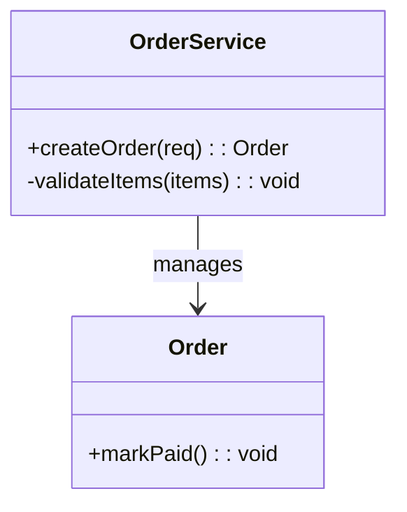
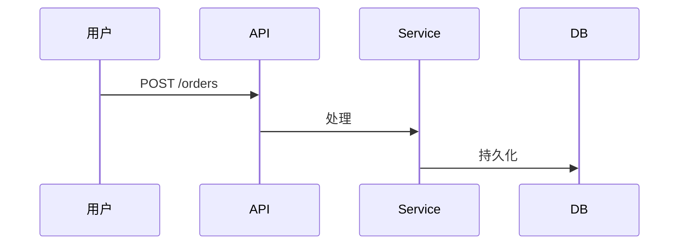
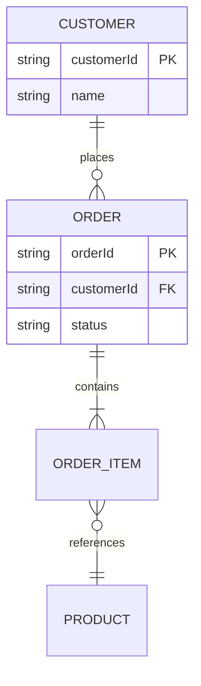

# 模板：3-详细设计

> 使用说明：`docs/3-详细设计.md`（**主文档**）。**必产文档**——概要设计讲清"为什么这么搭"，详细设计讲清"每个模块具体怎么实现"。叙述遵守 `_writing-guide.md`（`templates/_writing-guide.md`）。
>
> **规模与拆分（写之前先判定，不要写崩了再拆）**：预估正文 <60KB 且模块 <6 个 → **不拆**，全部内容写在本文件（下文各节照原样使用）。超过则按下表拆成扁平的多份文件（放在 `docs/` 根，不建子目录）：
>
> | 拆分件（`docs/` 根目录） | 承载本文件的 | 装什么 |
> |---|---|---|
> | `3.1-模块设计.md` | §2 各模块详设 | 每个模块 §2.x（承载条目/职责/链路表/条目规格/类结构/流程/算法/异常） |
> | `3.2-接口契约.md` | §3 接口设计 | API 清单 + 逐接口契约（**唯一权威**） |
> | `3.3-数据设计.md` | §4 数据设计 | ER + 表结构 + 字典索引（**唯一权威**） |
> | `3.4-界面索引.md` | §6 界面映射 | 界面元素 → 模块链路落点（有前端时） |
> | `3.5-底座契约.md` | §2.0.2 账本 | **条件件**：账本 >20 行才独立；否则留主文档 |
> | `3.x-业务规则设计.md` | §2 中独立成册的条目规格 | **条件件**：判定 / 计算 / 推导类条目按权威边界独立成册时（见下） |
> | `3.0-详细设计.md`（主） | §0 / §1 / §2.0 / §5 | 公共约定、总体架构、全系统索引、底座、横切机制 |
>
> **命名规则**：`3.x-<内容名>.md`；前五份内容名固定；**拆分后主文档改名 `3.0-详细设计.md`**（保证排在子文档之前）；`3.x` 的 **x 只表示排序，不承诺对应详设章节号**——对应关系写在文件头"承载"行，不靠文件名猜；不建 `docs/detailed/` 子目录。
> **业务规则拆分判定（权威边界三问，满足任一即成册）**：① 除本模块外，别的模块 / 运行时 / 配置 / 运营 / 外部系统也要读它；② 内容因业务原因频繁增删，而模块代码不常动；③ 需求里它已是会持续增删的清单。三条全否 → 融进模块小节的「条目规格」，**不设条数阈值**。文件名必须是通用文档类型词 `业务规则设计`，**禁止换成具体业务领域名称**。
> **拆分件文件头**：每个拆分件开头三行——`承载：3-详细设计的 §X` / `版本与日期（与主文档一致）` / `上游：2-概要设计 vX.Y`；正文从被拆出的那一节开始（**标题号沿用原编号**，如 3.2 从「§3 接口设计」起，不重编为 §1；业务规则设计件从「§2.x 条目规格」起）。
> **兜底阈值（默认不触发）**：模块 ≥12 个或 `3.1-模块设计.md` >80KB → 按**模块组**拆 `3.1.1-模块设计-<组名>.md`（**禁止每模块一份**）；账本 >20 行 → 账本移 `3.5-底座契约.md`。
> **索引层唯一**：模块总览表（§1.2）、动作清单总表（§1.3）、引用矩阵（§1.4）**只在主文档**，任何拆分件不得另立一份。
> **生成顺序**：先冻结索引（§1.2/§1.3/§1.4 的骨架）→ 写权威细节（3.2 / 3.3 / 3.5 及按三问独立成册的 3.x 业务规则设计）→ 逐模块写 3.1 → 每写完一册做**局部对账**（该册引用的编号都在权威处存在、权威处无孤儿）→ 全部完成扫**悬空引用 / 孤儿定义**。
>
> 六条硬要求：① 开篇 **§1「架构与模块总览」**给出总体技术架构、模块全集与全系统索引——**让读者一眼看清"系统由哪些模块组成、怎么搭、各有哪些动作"**（模块与概设 §3.1/§3.2 一致，冲突以概设为准）；② **概设 §3.2 点名的每个关键实现点，必须在对应模块逐一展开**（概设点了不写，等于没人写）；③ **对外契约、表结构、底座能力、业务规则只定义一次**（3.2 / 3.3 / 3.5 / 3.x 或主文档 §2.0.2），模块正文只写编号；④ **每个动作在模块链路表有行**，跨模块动作归发起模块；⑤ 有前端时须产出界面索引，把界面元素与后端处理对应起来；⑥ **每个模块先写「承载条目」**（认领哪些 REQ / BR），**判定 / 计算 / 推导类条目必须逐条写五要素**（§1.6）——只写"支持某规则"而写不出判据的，判为不可执行。调研素材落 `docs/refs/` 并回链概设 §12 调研记录。
>
> 红线：每个图后必须有文字解读；接口定义必须完整到下游工程师不用猜（编号 API-x）；非平凡算法按 **§1.5 硬门槛**写、禁止一句概括带过，但也不贴整段源码凑数。状态流转：草稿 → 已冻结（确认点 1）。

---

# 详细设计：[项目名称]

| 项 | 内容 |
|---|---|
| 版本 | v1.0 |
| 日期 | YYYY-MM-DD |
| 状态 | 草稿 / 已冻结 |
| 上游 | 2-概要设计 vX.Y |
| 与代码同步截止 | |

## 文档导读

> 本文件按"宪法 → 架构与索引 → 底座 → 模块详设 → 共享面"组织，读法如下（**拆分后各节落点见括号**）：
> - **§0 公共约定**：全系统共享的命名/错误码/枚举/"参考源映射"，是所有模块的宪法，先读。
> - **§1 架构与模块总览**：§1.1 总体技术架构（技术栈定版、分层与依赖方向、部署单元）、§1.2 模块总览表、§1.3 动作清单总表、§1.4 引用矩阵、§1.5 非平凡算法硬门槛、§1.6 条目精度门槛（判定 / 计算 / 推导类五要素）。**只想了解系统面貌，读到 §1 即可**；§1.2/§1.3/§1.4 是**索引层**，拆分后仍留本文件。
> - **§2.0 技术底座详设**（条件件，概设 §3.3 判定"有"时必产）：底座是先于业务模块的引擎（AI 编排运行时、规则引擎、告警引擎……），各模块链路表会引用它的调用点编号，故排在最前；判定"无"时写一行"无"。
> - **§2 各模块详设**（拆分后 → `3.1-模块设计.md`；条目规格独立成册时 → `3.x-业务规则设计.md`）：每个模块一小节（职责与功能点清单（含**承载条目**）→ **端到端链路表** → 类结构 → 关键流程 → 非平凡算法 → 异常边界 → **条目规格**），只读你关心的模块。**链路表是模块详设的第一权威**——随便挑一行，应能从触发源走到落库再走回来；**条目规格是判定 / 计算 / 推导类内容的唯一权威**，只写判据，不写"由配置驱动"。
> - **§3 接口设计**（拆分后 → `3.2-接口契约.md`）：接口清单 + 逐接口契约（编号 API-x），是 spec.md 契约的内联源。
> - **§4 数据设计**（拆分后 → `3.3-数据设计.md`）：ER 全图 + 每张表独立小节的表结构 + 数据字典与索引策略（数据库设计的唯一归宿）。
> - **§5 横切机制**（始终留本文件）：日志/错误码/鉴权/事务/配置等跨模块机制。
> - **§6 界面触发与前后端职责映射**（有前端时，拆分后 → `3.4-界面索引.md`）：**全局索引**——界面元素 → 触发命令 → 前后端职责，每行链到对应模块的端到端链路表；链路细节以模块链路表为权威。
>
> 阅读顺序建议：只想看清系统面貌 → §1；新人接手 → §0 → §4（先看数据长什么样）→ §3 → 目标模块；改接口 → 先改契约（§3）→ 回 §1.4 引用矩阵查全部引用点 → 逐个同步 → 重跑受影响动作。

## 0. 公共约定（全模块共享，先于此冻结）

> 本节是所有模块设计的"宪法"：模块分册只引用本节，不复写。**任何模块设计与本节冲突，以本节为准，回头修订模块设计；确需修改本节，走变更流程（4-变更记录）**。

### 0.1 命名规范

（包/类/表/字段/接口/API 路径的命名规则；代码标识符英文、注释中文。）

### 0.2 公共响应与错误码

统一响应结构：（成功/失败的响应体格式，分页结构，时间格式，ID 类型）

| 错误码 | 含义 | HTTP 状态 |
|---|---|---|
| 例：`AUTH-001` | | |

### 0.3 枚举字典

（全系统枚举集中注册：状态机取值、类型字典——各模块只能引用，不得新增同义枚举。）

| 枚举 | 取值 | 说明 |
|---|---|---|
| | | |

### 0.4 参考源映射（有原型/旧代码/mock 数据时必填）

| 参考源 | 作用域 | 本设计继承点 |
|---|---|---|
| 例：旧版 mock_data.py | GUI 展示字段 | 字段映射见各模块详设 |

## 1. 架构与模块总览

> **本文件开篇先给全貌，再进细节。** 本节是**索引层**：总体架构、模块总览、动作清单、引用矩阵都只在这里有一份，拆分件不得另立。模块全集与 2-概要设计 §3.1「模块总览表」**保持一致**——详设只做"镜像 + 落到实现"，**冲突时以概设 §3.1 为准并回改本表**，禁止两份文档各写一套（防漂移）。

### 1.1 总体技术架构（承接概设，落成定版）

> 概设讲"为什么这么搭"，本节讲"**落到实现时长什么样**"。只细化、不改语义；与概设冲突走变更流程。四件必须写：

- **技术栈定版**：语言 / 框架 / 运行时 / 数据库 / 中间件，写死主版本，并注明对应的 AD-x（与概设 §4 技术选型一致）；
- **分层与依赖方向**：界面层 → 接口层 → 业务模块 → 底座 → 数据层，写明**允许的调用方向与禁止项**（禁反向依赖、禁跨层直连、禁绕过底座账本）；
- **运行与部署单元**：进程 / 服务 / 容器怎么划，分别承载哪些模块与底座；
- **模块—底座关系图**：哪些模块调用了哪些底座能力（用 EXT-x 编号标注），图后必带解读。

（概设已有架构图与选型表的，这里不重画全图；只补"落到实现"的部分——目录/进程/依赖边界，并回链概设 §4/§5 与 AD-x。）

### 1.2 模块总览表

| 模块 | 用途 | 关联 REQ | 模块详设位置 | 代码落点 |
|---|---|---|---|---|
| 例：订单模块 | 下单 / 支付 / 退款的状态流转 | REQ-F-2.x | 本文件 §2.1（拆分后 `3.1-模块设计.md §2.1`） | `src/order/` |
| | | | | |

（每个模块一行；模块数、名称、用途须与 2-概要设计 §3.1 逐行对得上，不一致时**以概设 §3.1 为准回改本表**。增删模块走变更流程，不在此处顺手改。**模块依赖关系见 2-概要设计 §3.1，此处不重复**。未拆分时"模块详设位置"填 `本文件 §2.x`；拆分后填 `3.1-模块设计.md §2.x`——**这是全文档组唯一的模块位置索引**，拆分件里不得再抄一份模块总览表。）

### 1.3 动作清单总表（全系统权威，行键 = 动作）

> 回答"系统里到底有哪些动作、各归谁、走什么接口、动哪些表"。**全量，不许抽样**：来源 = 需求分析核心场景步骤（P0 必须步骤级）+ 概设 §3.2 的触发源 + 界面元素。**一个动作一行**；**跨模块动作归发起模块**，其余模块在自己链路表里引用同一动作名，不各写一半。新增动作**追加到表末取新号，不重排**。

| # | 动作 | 归属模块 | 触发源 | 调用接口 | 涉及表 | 底座调用 | 模块链路落点 | 关联 REQ |
|---|---|---|---|---|---|---|---|---|
| 1 | 例：登录 | 认证模块 | 登录页"登录"按钮 | API-1 | t_user / t_login_log | EXT-2 | `3.1 §2.1 #1` | REQ-F-1.1 |

（本表只给"有哪些动作、落到哪"；**动作的完整链路（校验顺序、落库、回传、失败降级）只写在对应模块的链路表**，此处不复写。跨文件引用写「动作清单 #N」或动作名，两者都稳定。）

### 1.4 引用矩阵（编号 → 定义处 → 引用点）

> **跨文件一致性的唯一凭证，也是修订传播的依据**：改任何一条定义，先在本表查出全部引用点，逐个同步，再重跑受影响动作。规则：
> - 每条编号（API-x / 表名 / EXT-x / 错误码 / 枚举 / 动作）**一行**；
> - **定义处只有一处**（本表列出的那个文件），别处只引用、不复写；
> - **引用点为空 = 孤儿**（定义的没人用，多半漏写了动作或漏了模块）；
> - **引用有、定义无 = 悬空**（不合格，补定义或删引用），两种都必须在交付前清空。

| 编号 | 类型 | 定义处 | 引用点（文件 §N / 模块 #M） | 状态 |
|---|---|---|---|---|
| API-1 | 接口 | `3.2 §3` | `3.1 §2.1 #1`、`3.4 行 1` | ✅ 2 处 |
| t_order | 表 | `3.3 §4.2` | `3.1 §2.1 #1`、`#3` | ✅ 2 处 |
| EXT-2 | 底座 | 主文档 §2.0.2 | `3.1 §2.1 #1` | ✅ 1 处 |

### 1.5 非平凡算法硬门槛（全模块通用，写模块详设前必读）

> **硬门槛（禁止以"逻辑直观"为由省略——这正是细节丢失的主因）**：凡命中以下任一，即属**非平凡**，必须在对应模块的「非平凡算法」小节展开：
> ① 状态机 / 多步流转；② 并发 / 去重 / 幂等 / 重试；③ 算法（匹配、排序、提取、解析、压缩、加密、批量或流式处理）；④ 边界与容错（大文件、超时、部分失败、脏数据）；⑤ 性能门槛（大数据量、内存 / IO 受限）。
>
> **另有一条强制项（不算"非平凡算法"，但同样不许省）**：⑥ **跨层调用链**——一个动作横跨 ≥2 层（界面 → 接口 → 引擎 → 落库）时，必须在模块「端到端链路表」给行，并在该模块「关键流程」节给至少 1 条时序或分步说明；跨层动作若自身还命中 ①-⑤，才再进「非平凡算法」展开。
>
> **每段必须写到四要素**：输入 → 输出；步骤（伪代码或流程）；关键参数与阈值（超时值 / 批大小 / 正则 / 复杂度）；失败与边界处理 + 性能量级（复杂度 / 内存 / 耗时）。
>
> **反省略自查**：写完对照 2-概要设计 §3.2 的「关键实现点」清单与 §12 调研记录，逐点确认"概设点到的实现点在此均有展开"——**概设提了而详设没展开，即不合格**。平凡的 CRUD 不贴代码凑数，但也不得用"实现相关逻辑"这类句子带过。

### 1.6 条目精度门槛（判定 / 计算 / 推导类，写模块前必读）

> **§1.5 管"实现有多难"，本节管"需求那条规则有没有写成能照着做的规格"**——两回事，都要过。
>
> **适用范围**（命中任一）：需求条目标为判定类 / 计算类 / 推导类；概设 §3.4B 点名要求过；内容是一份要逐条判定的清单（规则、档位、目录、条款、条件、策略）。
>
> **五要素（缺一即不可执行）**：
> 1. **触发条件**——什么时候开始判；
> 2. **判定条件**——怎么算命中，**含边界值**（等于阈值 / 空值 / 最小值 / 最大量 / 并列）；
> 3. **例外与覆盖**——什么**不算**命中，多条同时命中**谁优先**；
> 4. **结果动作**——命中了做什么，**失败怎么办**；
> 5. **位置与顺序**——在流程哪一步执行、与谁抢先后。
>
> **阈值与取值必须写来源**（需求原文 / D-x / 调研记录）——技能不替项目定业务判据，但必须把来源钉住。
>
> **验收要能判错**：每条至少对应 1 条 AC，且必须含反例（见 `ai-docs/acceptance-criteria.md`）。
>
> **反降维红线**：写成"支持某规则""由配置驱动""按既定策略处理"而不给判据的，一律判为不可执行——这是这类内容最常见的丢失方式，也是执行 AI 各自发挥的起点。
>
> **独立成册**：满足权威边界三问任一（独立消费方 / 独立变更节奏 / 需求已是可维护清单）→ 移入 `3.x-业务规则设计.md`；三条全否 → 写在模块 §2.x.7「条目规格」里。

## 2. 各模块详设

> **拆分后本节整体移入 `3.1-模块设计.md`**（该文件承载本设计的 §2，模块小节编号沿用 §2.x；文件开头写明"本文件承载 3-详细设计的 §2"）；未拆分时留在本文件。**模块总览表、动作清单、引用矩阵不在本节**——它们在主文档 §1，本文件不重复。
>
> 每个模块一小节，结构统一：**职责与功能点清单（含承载条目）→ 端到端链路表 → 类结构 → 关键流程 → 非平凡算法 → 异常边界 → 条目规格**。**端到端链路表是模块详设的第一权威**——§3 接口、§4 表、§6 界面索引都只引用它；缺此表即模块未完成。前端模块按同构详设：链路表 → 组件结构（组件树 / 状态管理 / 路由），关键流程 → 关键交互流程图，接口定义 → 组件 Props 契约。视觉 token 值以内联形式存在于 `ai-docs/spec.md` 工程约定节，实现时直接引用，不写死颜色/间距值。**前端占比高的项目：把前端各模块独立成小节（如 §2.3 前端模块详设），含组件树/状态管理/路由/Props 契约，不要塞在括号说明里。**

### 2.0 技术底座详设（条件件：概设 §3.3 判定"有"时必产；判"无"时本节写"无"）

> **为什么排在业务模块之前**：底座是"先于业务模块存在的引擎"（如 AI 编排运行时、规则引擎、告警引擎），各模块的端到端链路表会引用本节的调用点编号，所以先定义底座、再写模块。
>
> **边界**（判定口径见概设 §3.3，本节不重定义）：底座 ≠ 中间件使用——用 Redis / 消息队列是概设 §4 技术选型的事，不算本节；单模块独享的复杂逻辑留在该模块的「非平凡算法」里，也不进本节。本节只承接概设 §3.3 已判定为"有"的底座。
>
> **拆分条件件**：账本（§2.0.2）超过 20 行时，**账本与 §2.0.4 反向索引移入 `3.5-底座契约.md`**；主文档保留 §2.0.1 内部结构与职责边界、§2.0.3 底座算法，以及一张"能力清单"（EXT 编号 + 一句话能力 + 落点文件）。账本 ≤20 行时留在本节。

#### 2.0.1 内部结构与职责边界

（底座由哪些部分组成；它做什么；**明确不做什么**——防止业务逻辑慢慢渗进底座。）

#### 2.0.2 调用点账本（EXT-x / AIC-x，底座的对外契约全集中在此）

> 每条调用点 = 底座的一个对外能力。模块链路表只引用编号，**契约全文只写在这里**，禁止两处各写一份。

| 调用点 | 触发模块 | 触发时机 | 输入装配 | 输出契约（全文） | 校验 | 失败降级 | 预算 / 限流 | 可观测 |
|---|---|---|---|---|---|---|---|---|
| EXT-1 | | | | | | | | |

#### 2.0.3 底座的非平凡算法

（装配逻辑、编排顺序、投递分级、缓存策略等，按 §1.5 硬门槛四要素逐段展开。）

#### 2.0.4 与模块的联动（反向索引，防"另立门户"）

| 调用点 | 引用它的模块与链路表落点 |
|---|---|
| EXT-1 | `3.1 §2.x #N` |

### 2.1 模块 A 详设

#### 2.1.1 职责与功能点清单

**职责**：（这个模块拥有什么能力，一句话。职责含"和"或一句说不清，通常说明模块切错了，应拆开。实现需求分析的哪些 REQ。）

**承载条目**（本模块认领的 REQ / BR，必须与 2-概要设计 §3.2 的「承载需求条目」逐条对得上；概设认领到别的模块的，不在此重复）：

| 条目编号 | 条目类型 | 本模块的落点（§2.1.x / 链路表 #N） |
|---|---|---|
| BR-x | 判定类 | §2.1.7 条目规格 |

**功能点清单**（本模块对外提供的功能点，逐一列；对应 2-概要设计 §3.2 的「内容」）：

| 功能点 | 一句话说明 | 关联 REQ / 接口 |
|---|---|---|
| | | REQ-F-x.y / API-x |

#### 2.1.2 端到端链路表（每模块必产，无此表判未完成）

> **行键 = 一个动作**；**触发源不限于界面**——界面操作 / 定时任务 / 事件 / 上游模块调用都算一行。每行就是"从触发到落库再回来"的完整动作。随便挑一行，每一环必须能在本文件或引用编号处找到落点；缺环即本模块未完成。纯后端模块"界面元素"列填"—"，触发源写定时 / 事件 / 上游。
>
> **行号稳定**：表首列 `#` 是行号；跨文档引用一律写「模块 §2.x 链路表 #N」。修订时**新增动作追加到表末并取新号**，禁止重排已有行号；删行保留空号（该行标"—（已删）"），不回收、不递补。
>
> **「输入装配与校验」多步校验必须分步编号**：写明顺序与短路规则（例：`① 校验验证码，错则直接返回、不查库 → ② 查用户是否存在 → ③ 比对密码`），**禁止压缩成一句"校验通过后……"**——概设可以一句带过，详设的义务是把顺序、短路、每步失败走向列全。失败分支的错误码在此点出编号，处理差异落 §2.1.6。

| # | 动作（触发源·操作） | 界面元素 / 入口 | 调用接口 | 外部能力 / 底座调用 | 输入装配与校验 | 落库（表 / 状态） | 回传（返回 / 事件） | 失败与降级 |
|---|---|---|---|---|---|---|---|---|
| 1 | 例：保存设置 | 设置页"保存"按钮 | API-8 | EXT-2 | ① 长度校验（错则 400 短路）② 枚举校验 | user_setting 表 upsert | 返回新值 + changed 事件 | ① 失败 400；EXT-2 超时走本地默认值 |

#### 2.1.3 类结构

（图后解读：各类的职责、关键方法为什么长这样、关系是组合还是依赖。）

#### 2.1.4 关键流程

（图后解读：正常路径怎么走；上面至少有一条错误路径（超时/库存不足/校验失败）。）

#### 2.1.5 非平凡算法

（先按 §1.5 硬门槛判断本模块有无非平凡点：有则按四要素逐段展开；没有就写"本模块无非平凡算法"，不要留空。）

#### 2.1.6 异常与边界处理

> **概设一句带过的（如"登录失败要提示"），这里的义务是把所有失败情况列全**——接口契约里每个错误码对应到这里给处理策略；接口清单之外的内部异常（定时失败、上游超时、数据脏）也在本表登记。

| 场景 | 处理策略 | 关联 BR |
|---|---|---|
| | | |

**策略类异常必须给确定值**：次数、阈值、时长、解锁/恢复方式全部写死——例："密码连错 **5 次**锁定 **15 分钟**，到期自动解锁，锁定期间返回 `AUTH-LOCKED`"，**禁止"多次""一段时间"这类模糊词**；定不下来的升 TBD 交用户拍板（附建议默认值），不许留空。

#### 2.1.7 条目规格（判定 / 计算 / 推导类必产，其余类型写"无"）

> 按 §1.6 判定本模块是否管辖这类条目。**管辖则逐条写全五要素**；不写"支持某规则""由配置驱动"这类降维表述。
>
> **拆分件写法**：若按权威边界三问独立成册，本节整体移入 `3.x-业务规则设计.md`，此处只留一行"本模块的判定 / 计算 / 推导类条目见 `3.x-业务规则设计.md` §X"。

**BR-x ｜ 条目类型：判定类 ｜ 一句话：**（这条规则管什么）

| 要素 | 内容 |
|---|---|
| ① 触发条件 | 什么时候开始判 |
| ② 判定条件（含边界） | 怎么算命中；等于阈值 / 空值 / 最小值 / 最大量 / 并列 时各怎么算 |
| ③ 例外与覆盖 | 什么**不算**命中；多条同时命中时的优先级 |
| ④ 结果动作（含失败） | 命中后做什么；执行失败怎么处理（重试 / 回滚 / 提示 / 记日志） |
| ⑤ 位置与顺序 | 在链路表第几步执行；与哪些条目、哪些模块抢先后 |
| 阈值与取值来源 | 需求原文 §x / D-x / 调研记录 |
| 对应 AC | AC-x.y（必须含反例） |

### 2.2 模块 B 详设（同构）

（结构同 §2.1，逐节补齐：职责与功能点清单（含承载条目）→ **端到端链路表** → 类结构 → 关键流程 → 非平凡算法 → 异常与边界 → 条目规格。前端模块按 §2 开头说明的同构方式处理。）

## 3. 接口设计

> **拆分后本节整体移入 `3.2-接口契约.md`**（承载本设计的 §3）；模块与其他文件只引用 API-x，**不复写契约**。本节是接口契约的**唯一权威**，spec.md 的契约从这里内联。

### 3.1 接口清单

（每个接口一个编号 API-x，供追踪矩阵和变更影响分析引用。同一接口在模块详设、架构图、清单、spec.md 里出现时必须一字不差。）

| 接口编号 | 接口 | 方法 | 用途 | 关联模块 | 详设章节 |
|---|---|---|---|---|---|
| API-1 | | | | | [§2.1.4 关键流程](#214-关键流程) / [§2.2 模块 B 详设](#22-模块-b-详设同构) |

### 3.2 接口契约

（每个接口一节，完整到调用方不用问。同一份接口在模块详设、架构图、清单里出现时必须一字不差。给 AI 用的契约同步内联到 `ai-docs/spec.md`。**失败处理有差异的**（锁定、降级、特殊策略），错误码行标注落点（如 §2.1.6），契约里不复写策略全文。）

| 项 | 内容 |
|---|---|
| 操作 | `POST /orders` |
| 用途 | 创建订单 |
| 认证 | Bearer token，需 `order:create` 权限 |
| 请求体 | `items`（数组，必填，≥1 项）；`items[].sku`（string，必填）；`items[].qty`（int，必填，≥1） |
| 成功响应 | `201`；`{ orderId, status: "PENDING", createdAt }` |
| 错误码 | **每个错误码单独一行：码 + 语义 + 触发条件**，禁止只罗列码值。例： `400 INVALID_ITEMS`——购物项校验失败（字段缺失/数量非法） `409 OUT_OF_STOCK`——部分商品库存不足，响应附缺货明细 `401 UNAUTHORIZED`——token 缺失或过期 `429 RATE_LIMITED`——限流触发 |
| 幂等 | 通过 `Idempotency-Key` 请求头 |

## 4. 数据设计

> **拆分后本节整体移入 `3.3-数据设计.md`**（承载本设计的 §4）；表名、字段、约束、索引只在这里定义，模块与其他文件只引用表名。

### 4.1 实体关系全图

### 4.2 表结构定义

> **格式要求：每张表一个独立小节**，禁止把所有表的字段挤进一张大表。小节标题 = 表名 + 表注释；字段表列：字段名 / 类型 / 约束 / 字段注释。约束写全：主键（PK）、外键（FK→表.字段）、唯一（UNIQUE）、非空（NOT NULL）、默认值、CHECK。

#### store 门店表

| 字段 | 类型 | 约束 | 说明 |
|---|---|---|---|
| id | bigint | PK 自增 | 主键 |
| name | varchar(100) | NOT NULL, UNIQUE | 门店名称 |
| status | varchar(20) | NOT NULL, 默认 ACTIVE | ACTIVE/INACTIVE |

#### user 员工账号表

| 字段 | 类型 | 约束 | 说明 |
|---|---|---|---|
| id | bigint | PK 自增 | 主键 |
| store_id | bigint | FK→store.id | 归属门店（0=总部） |
| username | varchar(50) | NOT NULL, UNIQUE | 登录名 |

（有多少张表写多少个小节，一一展开，不合并。）

### 4.3 数据字典与索引策略

（字段业务含义；建了哪些索引、为什么。）

## 5. 横切机制

> **始终留在主文档**：日志 / 错误码 / 鉴权 / 事务 / 配置等机制只给本团队读，没有外部消费方，拆出去只会多一处引用。

（日志规范、错误码体系、鉴权流程、事务边界、配置管理——如有。）

## 6. 界面触发与前后端职责映射（有前端时必产）

> **拆分后本节整体移入 `3.4-界面索引.md`**（承载本设计的 §6）。
>
> **定位：全局索引，不是权威**。链路细节（输入装配 / 校验 / 落库 / 降级）的**权威在各模块的「端到端链路表」（§2.x.2）**；本表只负责"从界面视角总览 + 链到模块"——每行的"模块链路落点"列必须填对应模块章节，且不得与链路表重复或冲突（冲突以链路表为准）。
>
> 六列 + 索引列写全：**视图/界面元素 · 用户操作 · 触发命令或接口（API-x，契约见 §3）· 前端职责 · 后端职责 · 性能/算法注意 · 模块链路落点**。一个界面元素一行；一个操作触发多个接口就拆成多行。接口此处只引用编号，契约写在 §3。

| 视图 / 界面元素 | 用户操作 | 触发命令 / 接口 | 前端职责 | 后端职责 | 性能 / 算法注意 | 模块链路落点 |
|---|---|---|---|---|---|---|
| 例：书库列表页 | 点击"添加目录" | API-3 `POST /library/scan` | 弹目录选择器、显示扫描进度、分页加载列表 | 异步遍历目录、解析 EPUB/TXT 元数据、写库并回传进度 | 数十万文件须流式扫描 + 分批回传，禁止一次性载入内存 | `3.1 §2.3 #1` |
| 例：阅读页 | 打开大文本文件 | API-7 `GET /book/{id}/content` | 按需渲染可视区域、滚动时增量取下一段 | 按偏移分片读取、跳过索引段 | 50MB 文本必须流式渲染，禁止整文件读入 | `3.1 §2.4 #1` |
