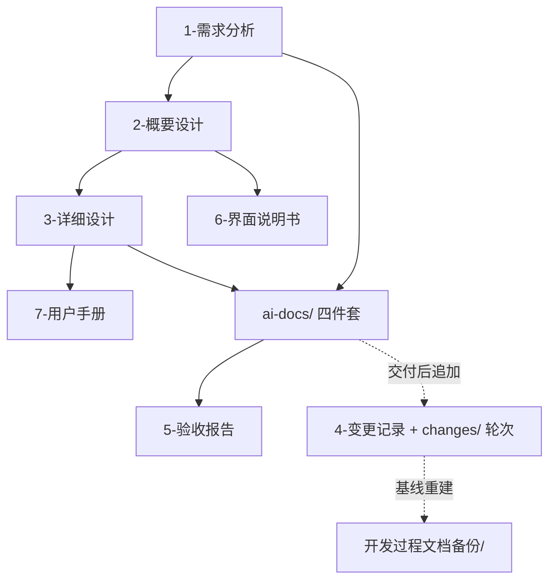

# 模板：文档清单与导航（必产）

> 使用说明：`docs/文档清单与导航.md`。它是整个文档组的导航中枢，回答"谁该读什么、文档之间什么关系、文档对应代码在哪里、什么算冻结"；同时是**文档状态的唯一权威**（各文档头部的"状态"字段应写"见文档清单与导航"），**也是需求承接台账的唯一权威**（§2）。随文档组变更同步更新（每份文档升版时更新对应行）。叙述遵守 `_writing-guide.md`（`templates/_writing-guide.md`）。

---

# 文档清单与导航：[项目名称]

**更新日期：** YYYY-MM-DD
**文档总数：** N 份（给人看的 M 份 / 给 AI 看的 K 份）
**项目阶段：** （需求确认 / 设计冻结 / 执行中 / 已交付）

## 1. 项目数字速查板（一致性哨兵）

> 每次文档改版后核对这些数字——对不上说明有文档没同步。这是防漂移的最廉价手段。

| 项 | 数量 | 说明 |
|---|---|---|
| 需求（REQ） | | 含功能与非功能 |
| 模块 | | 以概设模块总览表为准 |
| 接口（API） | | 以详设/ spec 一致数为准 |
| 业务规则（BR） | | |
| 任务（T） | | |
| 验收标准（AC） | | 含 AC-E / AC-NF |
| 自测用例（TC） | | |
| 错误码 | | |
| 承接台账覆盖 | | 有落点的条目数 / 条目总数（两个数不等时，差集必须在 §2.2 例外表里逐条有解释） |

## 2. 需求承接台账（唯一权威）

> **唯一权威**：需求分析里的每一条（REQ / BR / 约束 / 排除项），在本套文档里的下落**只记在这里**。不要在需求、概设、详设各记一遍——那会立刻变成三处说法、三处漂移，正是要治的病。
>
> 两段分工：**A 段机械核对**，只写落点、不写理由；**B 段只登记不走常规路径的条目**，必须写原因与决策人。
>
> **状态固定五值**：已承接 / 已细化 / 需求未定暂不做 / 本期不做 / 合并至 X。任何条目只有这五种去向，**不存在"下落不明"**。

### 2.1 A 段 · 常规承接表

| 条目编号 | 概设落点 | 详设落点 | 状态 |
|---|---|---|---|
| REQ-F-1.1 | 概设 §3.2 模块 A | 详设 §2.1 / `3.1` §2.1 | 已承接 |
| BR-1 | 概设 §3.4B | `3.1` §2.1.7 条目规格 | 已细化 |

> 落点必须可定位（章节号 / 链路表行号 / 文件），**禁止"见相关章节"**。`已细化` 专用于判定 / 计算 / 推导类——五要素已写全才可标。

### 2.2 B 段 · 例外表

| 条目编号 | 例外类型 | 原因 | 决策人/日期 | 下游如何引用 |
|---|---|---|---|---|
| BR-x | 需求未定暂不做 | 需求阶段未定（TBD-x） | 张三 / 2026-01-01 | 概设 §3.4、详设 §2.x 同句写明"因需求未定，本期暂不做"；不写 AC、不排任务 |
| BR-y | 本期不做 | 与 EX-2 冲突，本期排除 | 李四 / 2026-01-02 | 验收不为此条写 AC，变更记录留 CHG-x |
| BR-z | 合并至 BR-1 | 与 BR-1 判定条件重叠 | 张三 / 2026-01-03 | 各处只引用 BR-1 |

> **"需求未定"必须一路传下去**：概设、详设都要写同一句"因需求未定，本期暂不做"。只留在需求里，后面看设计的人会以为当初没提。
>
> 本期确实没有判定 / 计算 / 推导类条目时，在 A 段写一行"本期无判定类条目"，不要留空。

### 2.3 反向点名（交付前必做，缺一条即不合格）

按需求分析 §4 / §5 的条目花名册**逐条**查：

1. 编号在 A 段或 B 段有行吗？
2. A 段的概设 / 详设落点**真实存在**吗（能点开核对）？
3. 状态为"需求未定暂不做 / 本期不做"的，B 段有原因与下游引用方式吗？
4. 判定 / 计算 / 推导类的，`acceptance-criteria.md` 有对应 AC 且**含反例**吗？

> 为什么必须反向点名：正向逐节读设计，读不出"本该有、但没有"的内容——**正向检查对缺席是盲的**。只有以需求全集为分母逐条点名，才能发现整类内容失踪。

## 3. 确认点定义（本项目用到哪些关卡）

> 全库引用的"确认点 0/1/2"统一在此定义，别处只引用不另说。

| 确认点 | 关卡 | 谁确认 | 确认什么 |
|---|---|---|---|
| 确认点 0 | 需求输入定稿 | 用户 | 需求条目全集（分支 A 调研结果 / 分支 B 拆解结果） |
| 确认点 1 | 人类文档冻结 | 用户 | README / 需求分析 / 概要设计 / 详细设计 / 文档清单与导航 / 变更记录（交一页摘要；**§2 承接台账已填、反向点名通过**） |
| 确认点 2 | AI 四件套冻结 | 用户 | spec / execution-plan / acceptance-criteria / test-plan（装傻测试 + 生成期对账通过；**反向点名到 AC、判定类含反例**） |

## 4. 文档体系总览

## 5. 文档清单（状态唯一权威）

> 每份文档头部的"状态"字段写"见本文档"。状态取值：草稿 / 已冻结 / 已废弃（REMOVED 需求相关条目）/ 已回填。

| 层 | 文档 | 版本 | 状态 | 路径 | 内容摘要 |
|---|---|---|---|---|---|
| 给人看 | README | | | `README.md` | 定位/索引/执行入口 |
| 给人看 | 1-需求分析 | | | | |
| 给人看 | 4-变更记录 | | | | |
| 给人看 | 2-概要设计 | | | | AD-x 唯一家 |
| 给人看 | 3-详细设计 | | | | 拆分时主文档改名 `3.0-详细设计.md` |
| 给人看 | 详细设计拆分件 | | | `3.1` / `3.2` / `3.3` / `3.4` / `3.5` / `3.x-业务规则设计` | 逐份登记；`3.x` 只表排序，对应章节看文件头"承载"行 |
| 给人看 | 6-界面说明书 | | | | 有前端时：人读界面说明 |
| 给人看 | 7-用户手册 | | | | 面向最终用户（先占位） |
| 给人看 | 5-验收报告 | | | | |
| 给人看 | changes/ 追加台账 | | | `changes/README.md` | 首版交付后每轮一行，轮内见 `round-NN/` |
| 过程备份 | 旧整套文档（baseline-vN） | | 已归档 | `开发过程文档备份/` | 基线重建时旧文档整体归档，留痕不参与权威 |
| 素材库 | refs（主文档素材库） | | | `refs/` | 概设/详设主动调研拉取的外部参考件，索引 `refs/README.md`（目录名用 refs，避免与 Typora 附件目录 assets 混淆） |
| 给 AI | spec.md | | | `ai-docs/` | |
| 给 AI | execution-plan.md | | | `ai-docs/` | |
| 给 AI | acceptance-criteria.md | | | `ai-docs/` | |
| 给 AI | test-plan.md | | | `ai-docs/` | |

## 6. 角色阅读路径

| 角色 | 阅读路径 |
|---|---|
| 管理者/决策者 | README → 1-需求分析（背景与目标） → 2-概要设计（架构） |
| 后端开发 | ai-docs/spec → execution-plan → 3-详细设计（对应模块） |
| 前端开发 | ai-docs/spec → execution-plan → 6-界面说明书 → 3-详细设计（前端模块） |
| 只看界面/非技术读者 | 6-界面说明书（界面有什么、怎么操作） → 原型 |
| 新加入成员 | README → 1-需求分析 → 2-概要设计 → 按角色选读 |
| 验收/测试 | acceptance-criteria → test-plan → 5-验收报告 |

（按项目实际角色裁剪。）

## 7. 文档与代码目录对应

| 文档 | 代码目录 |
|---|---|
| 3-详细设计-数据模型 | `database/migrations/` |
| execution-plan | `backend/`、`frontend/` |

## 8. 冻结条件与变更流程

**冻结条件**：该阶段确认点（见 §3）通过 + 用户确认 + 版本号写入本文档。

**变更流程**：任何变更先入 `4-变更记录.md` → 用追踪矩阵（ai-docs/execution-plan §5）确定受影响面 → 两组文档同步增量修订 → **同步更新 §2 承接台账的落点与状态** → 本文档对应行升版、数字速查板核对。禁止绕过变更记录直接改文档。

**追加需求轮次**（首版交付后一轮一轮追加的想法）：走 `changes/`，**一轮一目录**（`round-NN/`：讨论稿 / 干净清单 / 本轮自测）；**一律不回写本套文档**，冲突只登记（`todolist.md` §D + CHG-x 备查）。仲裁：**后轮 > 前轮 > 主文档**。架构类需求须先过**中立评审三问**才能冻结清单。追加减稳定后做一次**基线重建**：重生成干净文档、旧整套（含已并入轮次）归档到 `开发过程文档备份/baseline-vN/`（见 SKILL.md §9.3）。

## 9. 文档质量保障

- 每份文档交付前过对应确认点的自查清单（见技能 checklists.md）
- **交付前做一次反向点名（§2.3）**：以需求全集为分母逐条查下落——正向检查对"整类缺席"是盲的
- 每个迭代结束做文档与代码一致性检查（实现 vs 契约）：**发现冲突先走文档变更流程（4-变更记录），再动代码**——禁止绕过变更记录直接改文档
- 可选：引入第三方 AI 评审，评审意见入 4-变更记录，按 P0/P1/P2 分级处理
